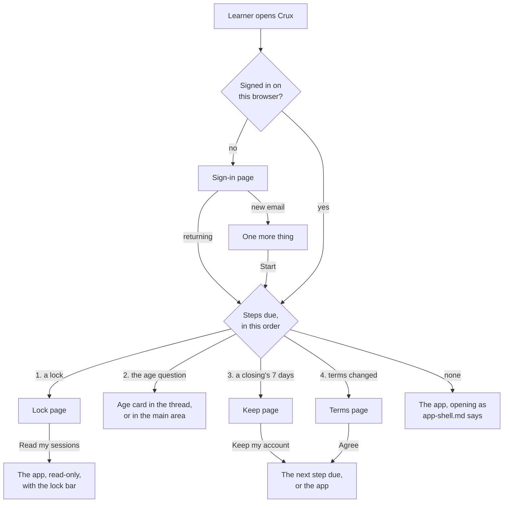

# Sign-in, settings, feedback and closing on screen

**Draft: not locked.** Part of the [Crux v1 spec](README.md). Terms are as [`GLOSSARY.md`](../../GLOSSARY.md) defines them.

This file covers the screens around an account: the sign-in page, the steps shown on opening, a locked account, the Settings page, the feedback page and closing an account. All of it comes from [#753] unless a line says otherwise. The rules these screens show are in [`accounts.md`](accounts.md), [`age.md`](age.md), [`privacy.md`](privacy.md), [`feedback.md`](feedback.md), [`spending.md`](spending.md) and [`misuse.md`](misuse.md). The app around them is in [`app-shell.md`](app-shell.md). The prototype the owner chose from is on the throwaway branch `prototype/753-account-screens`, variant A except where this file says otherwise.

## Signing in

- **Sign-in page:** its own page, one centred card, with no app or landing page around it. The landing page's "Sign in" leads to it. Each step replaces the last inside the card.
- The card is headed "Sign in or sign up". It starts with "Continue with Google", then "or", the email field and "Email me a code". The human check, when it shows, sits under the email field.
- The code step reads "Check your email" and "We sent a 6-digit code to ana@example.com. It works for 10 minutes.", then the code boxes, Continue, and "Send a new code" · "Use another email".
- After the code or Google, a new email gets "One more thing" in the same card (see [`accounts.md`](accounts.md)). Start stays greyed until both ticks are ticked.
- "Crux is full for now", with its tick-box and Done, and the misuse block replace the ticks in that card. Done goes to the landing page. The misuse block reads "This email can't be used to make a Crux account.", with Back to the sign-in card.

### Messages

Each message shows in the card under the button or field it is about:

| When | Under | Message |
|---|---|---|
| The sender is out for the day or the month | Email me a code | The sender-out message in [`accounts.md`](accounts.md) |
| 10 codes today for one email | Email me a code | "Too many codes today. Use Continue with Google, or try again tomorrow." |
| 3 codes this hour for one email, or 20 from one network | Email me a code | "Too many code requests. Try again in an hour, or use Continue with Google." |
| From the EU or the UK | The button tapped | "Crux isn't available in your region yet." |
| Inside LinkedIn's or Facebook's browser | Continue with Google | The in-app note in [`accounts.md`](accounts.md) |
| A wrong code | The code boxes | "That code isn't right. 3 tries left." |
| An expired code, or the fifth wrong try | The code boxes | "This code doesn't work any more. Send a new one." |

## Steps on opening

- **Opening page:** a plain page like the sign-in page, holding one card, with nothing from the account behind it. The lock, "Keep my account", the terms-changed step and the under-18 closure each use one.
- The age question keeps its place: a card in the thread, or in the main area when no conversation is open (see [`learning-screen.md`](learning-screen.md) and [`app-shell.md`](app-shell.md)). The order stays as [`accounts.md`](accounts.md) gives it: a lock, the age question, "Keep my account", then the terms step.

### Keep my account

- The card reads "Your account closes on 10 Nov." and "Everything in it is erased that day, unless you keep it."
- Then "Keep my account", "Sign out" with "It still closes on 10 Nov. You can come back and keep it until then." under it, and "Send me a copy first".
- A "Your feedback" link opens the learner's feedback list alone on the plain page, with Back. It lets the learner untick a quote or a share during the 7 days (see [`feedback.md`](feedback.md)). The app stays closed.
- "Keep my account" goes to the next step due, or the app.

### The terms step

- The card is headed "Crux's terms changed", then the line in [`privacy.md`](privacy.md), "Read the new Terms" · "What changed", Close my account and Agree.
- Close my account opens the close-account dialog below, over the terms page.

### The under-18 closure

- An opening page: "Your account is closed" and "Crux is for people 18 and over, so your account and everything in it have been erased.", with OK, which goes to the landing page.

## A locked account

- On opening, the lock's card comes first on its own page, headed "Your account is locked", with "Read my sessions" and Sign out.
  - **A misuse closure:** "Crux's owner closed your account on 3 Nov. The tutor declined 3 of your requests (making drugs or other illegal goods), and the owner read those sessions. Your account will be erased on 10 Nov. To contest this, reply to the email we sent you before then." and "You can still read your sessions and what you've mastered. The tutor can't reply."
  - **A sealed flag:** "One of your sessions was sealed, and your account is locked while Crux's owner decides. Nobody can open the sealed session, including Crux's owner. To reply, email Crux at its address and quote flag 4821." and "You can still read your other sessions. The tutor can't reply."
- When a seal locks the account while the learner is in the app, the lock's page shows at once. Behind "Read my sessions", the sealed session shows its sealed message (see [`app-shell.md`](app-shell.md)).
- "Read my sessions" opens the app read-only. Each session shows the **lock bar**, "Your account is locked. Why?", and the chat box's place reads "Your account is locked, so the tutor can't reply." "Why?" brings the lock's card back.
- What a lock allows is in [`misuse.md`](misuse.md). On screen, "+ New session", Rename, Close account and the feedback page's Send are greyed. In a misuse closure, Delete, the file × and the held session's Remove are greyed too.
- Greyed items say "Your account is locked, so this can't be changed."; Close account says "A locked account can't be closed."; the feedback page says "Your account is locked, so you can't send feedback. You can still untick a quote or a share in Settings, under Your feedback."

## Settings, Feedback and Sign out

- The sidebar's foot holds, under "What you've mastered": "Feedback", then "⚙ Settings" with the account's email under it. On a phone they are at the foot of the drawer.
- The Feedback link is hidden while a mastery check is open on screen. A half-done check in another session does not hide it ([#734]).

### The Settings page

One page in the main area, with four parts in this order:

- **Tutoring:** "Today's tutoring: 70% used" with a bar, and "This week: 45% used" under it (see [`spending.md`](spending.md)).
- **Files:** "Your files: 186 of 200 MB" with a bar, and "See your files". It opens the allowance dialog in [`app-shell.md`](app-shell.md), starting "Your files are using 186 of 200 MB." in place of the "wasn't added" line.
- **Your feedback:** "Untick to withdraw a quote or end a share." Then each answer sent, newest first: "8 Nov · Helped: yes · Would pay: maybe", its text, the quote tick, the share tick ("Share: Personal essay (the owner can read it up to 8 Nov)"), and "You said Crux may email you about this." when that tick was given. An answer with neither tick reads "Not quoted, not shared."
- **Account:** the email, Close account, the Terms, Privacy Policy and "Who runs Crux" links, then Sign out, last on the page.

### The feedback page

- One page in the main area, with the whole form: the four questions in [`feedback.md`](feedback.md), "0 / 2,000" under each text box, then the three ticks, then Send. The after-first-mastery notice's link opens the same page.
- The share tick names a session ("Share: Personal essay"), with a list to change it that ends in "all my sessions". When ticked, its warning shows under it.
- Past 5 sends a day, the message in [`feedback.md`](feedback.md) shows above Send, and Send is greyed.
- After Send: "Thanks, your feedback was sent." with "Back to learning".

## Closing an account

- Close account opens a dialog over the Settings page, like the other dialogs that erase something: "Close your account?", then "This erases your 4 sessions, your files, and your record of 3 mastered topics on 10 Nov. Until then, open Crux and choose Keep my account to stop it.", "Send me a copy first", "Type delete to confirm" with its box, Cancel and Close account.
- Close account works only once "delete" is typed, in any case (see [`privacy.md`](privacy.md)).
- "Send me a copy first", in this dialog or on the "Keep my account" card, turns into "We'll email ana@example.com a copy on 10 Nov, as a private link that works for 7 days."
- Right after closing, the learner is signed out on that browser and sees the sign-in page, with a note above the card: "Your account closes on 10 Nov. We've emailed you. Sign in before then to keep it." (see [`accounts.md`](accounts.md)).

### The emails

- **Closing:** subject "Your Crux account closes on 10 Nov", the line in [`privacy.md`](privacy.md), and a "Sign in to Crux" button.
- **The copy** (see [`operations.md`](operations.md)): subject "Your copy of your Crux data", then "Here is the copy of your Crux data you asked for. Your account and everything else has been erased.", a "Download your copy (zip)" button, "This link works until 17 Nov. Keep it private: anyone with the link can open your data." and "A missed link can't be made again."

## Frontend modules

| Module | What it holds |
|---|---|
| Sign-in | The sign-in page: the two ways in, the human check, the code step, its messages, "One more thing", the full and blocked cards, and the note after closing |
| Opening steps | The opening pages and their order: the lock, "Keep my account" with its feedback list, the terms step and the under-18 closure; the lock bar and the read-only states |
| Settings | The Settings page's four parts, "See your files", unticking quotes and shares, Sign out, and the close-account dialog with its typed "delete" |
| Feedback | The feedback page, the share list and warning, the sent and stopped states, and the sidebar link |

[#734]: https://github.com/calmxz/Crux/issues/734
[#753]: https://github.com/calmxz/Crux/issues/753
