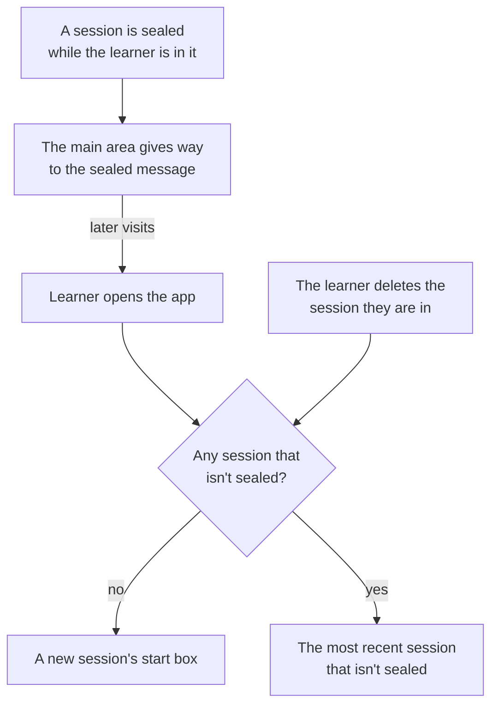

# The app shell, the session list and files on screen

**Draft: not locked.** Part of the [Crux v1 spec](README.md). Terms are as [`GLOSSARY.md`](../../GLOSSARY.md) defines them.

This file covers the app around the session screen: where the app opens, the session list, the all-sessions page, "What you've mastered", and how files are added, read and removed on screen. All of it comes from [#752] unless a line says otherwise. The session screen itself is in [`learning-screen.md`](learning-screen.md). The rules these screens show are in [`files.md`](files.md), [`sessions.md`](sessions.md), [`misuse.md`](misuse.md) and [`sealed-sessions.md`](sealed-sessions.md). The prototype the owner chose from is on the throwaway branch `prototype/752-files-and-sessions`, variant A except where this file says otherwise.

## The shell

- **Sidebar:** on desktop, the session list beside the session screen, always in view. On a phone, the same list is a drawer opened from "☰" in the top bar. It holds "+ New session" at the top, the session list, and "What you've mastered" at the bottom, with Feedback and Settings under it (see [`account-screens.md`](account-screens.md)) ([#753]). The session list shows the 10 most recent sessions, by last visit, then "All sessions (24)", which opens [the all-sessions page](#the-all-sessions-page). A learner with 3 sessions sees all 3, then "All sessions (3)" ([#780]).
- **The search button** (🔍) sits at the right of the sidebar's top bar, in line with "Crux". Screen readers read it as "Search sessions". It opens the all-sessions page with the cursor in its search box. On a phone it is only in the drawer's top bar, so search takes two taps: ☰, then 🔍 ([#780]).
- **The owner's sidebar** also holds "Owner" above Feedback and Settings, shown only to the owner's main address (see [`owner-screens.md`](owner-screens.md)) ([#755]).
- **A guest's sidebar** holds the guest's own parts, and a trial link's foot reads "Trial link" in place of the email (see [`landing-screens.md`](landing-screens.md)) ([#754]). A guest's sidebar has neither the search button nor the "All sessions" line. A trial link gets the sidebar and the all-sessions page exactly as an account does ([#780]).
- **Main area:** the part of the app beside the sidebar. It shows a session, "What you've mastered", the all-sessions page, a sealed session's message, the Settings page or the feedback page ([#753], [#780]).
- Where the app opens:

- When the age question is due and no conversation is open (the start box, "What you've mastered", the all-sessions page, or a sealed message), its card shows in the main area until answered (see [`age.md`](age.md)) ([#780]).
- When a seal also locks the account, the locked account's screen comes first (see [`account-screens.md`](account-screens.md)) ([#753]).

## The session list

- Each line has three rows:
  - the session's name, then its badges, in this order: "Sealed", "Remove a file to continue" (held by a harmful file), "Check open", and "1 waiting". A sealed line shows only "Sealed". "1 waiting" counts messages marked as waiting for any reason: a switch, the region stop, a hold, the age question, a file's waiting read, or a broken reply ([#771], [#802]) (see [`at-a-limit.md`](at-a-limit.md));
  - "On: Range" while a topic is under way, or "Mastered last: The chain rule" when none is, then the last visit ("Today", "Yesterday", then a date such as "6 Nov"). A line with neither shows only the last visit;
  - while a topic is under way, a small bar and "3 of 4": that topic's objectives shown or passed, the same count as the phone strip (see [`learning-screen.md`](learning-screen.md)).
- Session names need not be unique. Every link points at a session, not its name.

### Rename and delete

- The session menu ("⋯") is on each sidebar line, on each line of the all-sessions page, and next to the session's title. All hold Rename and Delete ([#780]).
- Renaming edits the name in place, in the line or in the title. On desktop, clicking the title also starts renaming, with a pencil on hover. On a phone, renaming starts only from the menu. Enter saves, Esc cancels, an empty name keeps the old one, and a name is up to 80 characters.
- Delete opens a warning dialog naming what goes (see [`sessions.md`](sessions.md#deleting-a-session)): 'Delete "Chain rule (MATH101 week 6)"? This deletes everything in it, including 2 mastered topics from your record. It can't be undone.' Other cases name the half-done check, the passed objectives and the files. Cancel and Delete session.
- When deleting would take a mastered topic or a passed objective off the Record, or a half-done check would go, the learner types "delete", in any case, before the button works. Otherwise the two buttons are enough.
- A sealed session's menu has no Rename, and Delete is greyed out, with "A sealed session can't be deleted." (see [`sealed-sessions.md`](sealed-sessions.md)).

## The all-sessions page

The page that lists every one of the learner's sessions and holds [the session search](sessions.md#the-session-search). It opens in the main area. All of it comes from [#780]. The prototype the owner chose from is on the throwaway branch `prototype/780-all-sessions`.

- **Opening:** "All sessions (24)" and the search button always open it fresh: an empty search, every session newest first, at the top.
- **The page:** titled "All sessions", with "24 sessions" under the title, or "3 of 24 sessions match" while a search is typed. The empty search box reads "Search your sessions".
- **Lines:** each session is a line: its name and badges, then its last visit, then the progress bar while a topic is under way. The page leaves out the sidebar's "On:" and "Mastered last:" row; the sidebar keeps its full line. Each line has the session menu ("⋯") with Rename and Delete, working as in the sidebar: a sealed line has no Rename, and Delete is greyed out. The "⋯" next to an open session's title stays. Sealed sessions are listed with their "Sealed" badge, and tapping one shows the sealed message.
- **Dates** use the learner's own clock and print no time, with "Today" and "Yesterday" as in the sidebar: a session last visited at 8:00 pm on 7 Nov in New York shows "7 Nov" from 9 Nov, although it was 8 Nov in Philippine time (see [`dates.md`](dates.md)).
- **Order:** by last visit, newest first, with no filters and no other sort. With a search typed, matches keep that order; nothing ranks them by how well they match.
- **Loading:** the first batch of lines loads with the page. When the learner scrolls near the end, the next batch loads by itself, with "Loading...". There is no button. The batch size is left to the build.
- **Searching:** results follow the typing: the list narrows with each letter, after a short pause whose length is left to the build. The term travels in the request's body, never in an address (see [`security.md`](security.md#keys-in-addresses)), so it is in no history, shared link, log or Cloudflare sample. The page holds it in memory only: Back keeps it, and a reload clears it, including when the browser reloads a page it set aside. The search box asks the browser not to remember entries, so no past term is offered as a suggestion. Crux stores nothing new in the browser.
- **Back:** going back from a session opened from the page (the Back button or gesture) returns the page as the learner left it: the same search still typed, the same lines in the same order, at the same place, with the batches already loaded. The opened session's new last visit shows the next time the page opens fresh.
- Only the opened session's line is checked again on the way back: that one session is matched again against the search as it now stands. If it was deleted, its line is gone. With a search typed, a session sealed meanwhile keeps its line only if its name matches, with no snippet; one whose check started, or whose teaching is hidden again after reteaching, loses a snippet from hidden teaching, and keeps its line only if something it still shows matches; a renamed one, or one whose file was removed, keeps its line only if it still matches.
- **A locked account** can still open the page and search, since a lock leaves reading open. Each line's menu greys what the lock greys (see [`account-screens.md`](account-screens.md)).
- **One new backend call** returns the learner's sessions a batch at a time, newest visit first, with an optional search term in its body and each match's snippet.

### What a match shows

- A session matched in its conversation shows one snippet under its line, from the newest message that holds any typed word: up to two lines around the match, with "You:" or "Tutor:", "(waiting)" on a message still waiting, and "and 1 more in this conversation" when others match. The cut falls only between words outside maths, so a formula always shows whole and drawn as in the session; a word inside it is never highlighted. A diagram or graph shows as "(diagram)". Matched words are bold, on a soft tint (see [`themes.md`](themes.md)) ([#779]).
- A line found only by a topic or a file name shows "Topic: Range" or "File: MATH101 week 5.pdf" under the name. A line found by its name shows no such line.
- Tapping a snippet opens the session at that message, highlighted: it keeps its own colours, ringed in Crux's orange (see [`themes.md`](themes.md)) ([#779]). A session that opens at something needing an answer opens there instead, with no highlight: an open check, at the check; mid-teaching on a topic last worked on 7 or more days ago, at "continue" and "refresh first"; a session held by a harmful file, at its restated hold; and a due age question, at its card. A due age question comes before an open check, since the check pauses until the tap (see [`age.md`](age.md)). The tutor's restatement of where it was, and the after-mastery welcome back, don't count: those sessions open at the message.
- In a locked account nothing can be answered, so a snippet opens at its message, highlighted, with the lock bar as usual.

### When nothing shows

- No sessions: "No sessions yet." with "+ New session".
- No match: 'No sessions match "zebra".', then "The search looks through session names, topics, file names and conversations.", and "Clear search".
- When the page, a batch or a search can't load, "Crux can't be reached right now. Try again later." shows where the list, the batch or the results would be, with a "Try again" button that retries what failed. What has loaded stays, and scrolling or typing also tries again. A Cloudflare refusal first waits and tries once more (see [`security.md`](security.md#what-a-learner-sees)).

## What you've mastered

- It opens in the main area, in place of the session. It is the Record (see [`sessions.md`](sessions.md#what-the-learner-sees)).
- A filter at the top: By date, the default, and By session.
- **By date:** mastered topics newest first, each with its date and its session as a link; then a section of objectives passed on topics not yet mastered.
- **By session:** sessions by last visit, each a heading linking to it, with its mastered topics and passed objectives under it. When two sessions share a name, the heading adds the last visit: "Chain rule (5 Nov)".

## Starting a session

- A new session shows the **start box** before anything is sent: "What do you want to learn? Type a topic, add your files, or both", with Add files and Start. After the first send, it is the normal session screen.
- Files picked, or dropped onto the box on desktop, show as chips until Start. A file uploads as soon as it is picked. × on a chip before Start drops it at once, with no notice.

## Files on screen

- During a session, files come in through the file button in the chat box. On desktop, files dropped on the session screen are added the same way. Never during a check (see [`files.md`](files.md#types-and-limits)).
- A file's state shows under its name in the objectives panel: "Reading…", "Your file is saved. It'll be read when you're back tomorrow.", "Saved. It'll be read when files are back." while files are switched off, or "Couldn't read this file, so it wasn't added. Try again, or use another file." with Dismiss.
- The conversation keeps only the tutor's messages and Crux's own lines the spec already calls for when something changes. While a file given with the request is read, "Reading…" also shows in the conversation, in place of the reply the learner is waiting for.
- The fixed line after a read fills the limit reads "Lecture 7.pdf uploaded successfully." (see [`at-a-limit.md`](at-a-limit.md#files-at-a-limit)).
- A file of the wrong type, a file over 50 MB, or an upload over 100 pages gets a pinned line above the chat box, or under the start box. It stays until dismissed or until the learner leaves, and the file is never added:
  - "lecture 6.ppt: Please save this as a PDF or `.pptx`"
  - '"Full year notes.pdf" has 340 pages, over the 100-page limit for one upload: upload just the chapter you need.'
  - '"scan.pdf" is over 50 MB: upload just the chapter you need.'
- While files are switched off, or the 20 GB store is full, the file button, Add files and dropping are greyed. A tap shows a pinned line: "Files are paused while we fix something. Your files are kept.", or "New files can't be added right now. Your files are kept, and learning carries on."

### Reading a file

- A pointer ("as on slide 30") is a link that opens the **file viewer** at that page, highlighted. Tapping a file in the panel opens it at page 1. A pointer to a removed or held file is plain text, not a link.
- On desktop, the viewer takes the objectives panel's place, so the conversation and the chat box stay in view. Close brings the panel back. On a phone, it is full screen, with Close.
- The viewer shows the file's name, "Slide 30 of 31", the page, page thumbnails, and a slide's speaker notes under it.
- A file held for harm cannot be opened. Its row shows "The tutor can't help with this file. Remove it to continue." and Remove file. Other unusable files open as usual.

### Removing a file

- Each file row in the objectives panel has ×. It is hidden during a check, with the files.
- × opens a dialog before anything is erased: 'Remove "Lecture 8 slides.pptx"?', the notice from [`files.md`](files.md#removing-and-erasing), Cancel and Remove.

### The allowance

- A file past the allowance opens the **allowance dialog**: '"Lecture 9.pdf" wasn't added: your files are using 192 of 200 MB. Remove a file to make room.' Then every file across the learner's sessions, largest first, each with its session, size and Remove, and Close.
- Remove opens the removal dialog. A file in a session with an open check shows "in a check" in place of Remove. A sealed session's files are not listed (see [`files.md`](files.md#the-allowance-and-the-store)).
- The learner adds the file again once there is room.
- "See your files" in Settings opens the same dialog, starting "Your files are using 186 of 200 MB." in place of the "wasn't added" line ([#753]).

## A held session

- A session held by a harmful file (see [`files.md`](files.md#other-files)) shows its file's row as above, and a pinned line above the chat box: "This session is waiting until you remove reagents.pdf. Your progress is kept.", with "Remove reagents.pdf", which opens the removal dialog.
- This pinned line cannot be dismissed. It goes when the file is removed.
- Pinned lines stack: the held line first, then the rest in the order they came.

## A sealed session

- Tapping its line shows the sealed message in the main area, in place of the session: "This session is sealed. Nobody can open it, including Crux's owner. Your other sessions keep working. Please don't upload that file again. To reply, email Crux at its address and quote flag 4821." "Your other sessions keep working" is left out when the account is also locked. The address works for trial links, which have no account email. The message adds the fixed reason line in [`sealed-sessions.md`](sealed-sessions.md) ([#764]).
- When a session is sealed while the learner is in it, the main area gives way to the sealed message at once. Later visits open as [The shell](#the-shell) says.
- Its line shows its name if it has one. A session sealed on its first typed request never had a name, so it shows "Sealed session", never the first words of the blocked request.
- Every way into it from "What you've mastered", or from a "passed in" mark, shows the sealed message. A message naming it elsewhere uses its line's name, and leaves out "open … to pick it up": "You mastered this in Reaction rates on 20 Oct." (see [`sealed-sessions.md`](sealed-sessions.md)).

## Jump points

- Each jump point (see [`sessions.md`](sessions.md#what-the-learner-sees)) is a labelled divider in the conversation: "Topic: Implicit differentiation", "Diagnostic", "Objective 1: y terms", "Objective 1 again", "Mastery check: result".
- The jump menu ("Jump") in the session's top bar lists them in order, with the current one highlighted. Both are hidden during a check.

## Frontend modules

| Module | What it holds |
|---|---|
| App shell | The sidebar and drawer, with the search button, the 10 most recent sessions and "All sessions (24)", where the app opens, and the main area's switch between a session, the Record, the all-sessions page and the sealed message ([#780]) |
| Session list | Lines, badges, progress bars, the session menu, renaming and the delete warning |
| Record | "What you've mastered", with its By date and By session filter |
| Files | The start box's chips, the file button and dropping, file states, the removal and allowance dialogs, and the pinned file lines |
| File viewer | Pages, thumbnails, speaker notes and the highlighted page |
| All-sessions page | The page, its search box, its lines and snippets, loading as the learner scrolls, and its empty and unreachable lines ([#780]) |

The session screen's modules (see [`learning-screen.md`](learning-screen.md#frontend-modules)) gain the session menu and the jump menu in the top bar, "Mastered in this session", and the file rows' states and ×.

[#752]: https://github.com/calmxz/Crux/issues/752
[#753]: https://github.com/calmxz/Crux/issues/753
[#754]: https://github.com/calmxz/Crux/issues/754
[#755]: https://github.com/calmxz/Crux/issues/755
[#764]: https://github.com/calmxz/Crux/issues/764
[#771]: https://github.com/calmxz/Crux/issues/771
[#779]: https://github.com/calmxz/Crux/issues/779
[#780]: https://github.com/calmxz/Crux/issues/780
[#802]: https://github.com/calmxz/Crux/issues/802
