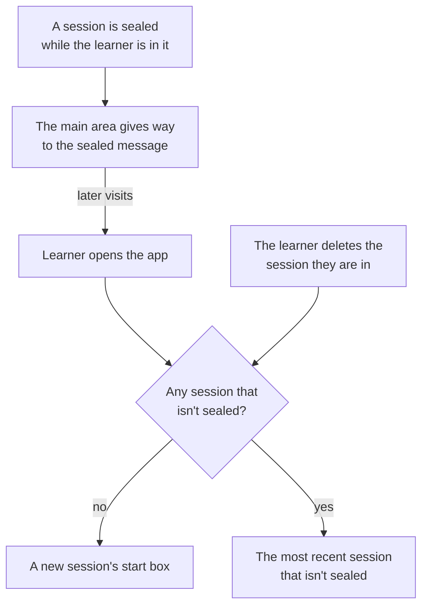

# The app shell, the session list and files on screen

**Draft: not locked.** Part of the [Crux v1 spec](README.md). Terms are as [`GLOSSARY.md`](../../GLOSSARY.md) defines them.

This file covers the app around the session screen: where the app opens, the session list, "What you've mastered", and how files are added, read and removed on screen. All of it comes from [#752] unless a line says otherwise. The session screen itself is in [`learning-screen.md`](learning-screen.md). The rules these screens show are in [`files.md`](files.md), [`sessions.md`](sessions.md) and [`misuse.md`](misuse.md). The prototype the owner chose from is on the throwaway branch `prototype/752-files-and-sessions`, variant A except where this file says otherwise.

## The shell

- **Sidebar:** on desktop, the session list beside the session screen, always in view. On a phone, the same list is a drawer opened from "☰" in the top bar. It holds "+ New session" at the top, the session list, and "What you've mastered" at the bottom, with Feedback and Settings under it (see [`account-screens.md`](account-screens.md)) ([#753]).
- **Main area:** the part of the app beside the sidebar. It shows a session, "What you've mastered", a sealed session's message, the Settings page or the feedback page ([#753]).
- Where the app opens:

- When the age question is due and no conversation is open (the start box, "What you've mastered", or a sealed message), its card shows in the main area until answered (see [`age.md`](age.md)).
- When a seal also locks the account, the locked account's screen comes first (see [`account-screens.md`](account-screens.md)) ([#753]).

## The session list

- Each line has three rows:
  - the session's name, then its badges, in this order: "Sealed", "Remove a file to continue" (held by a harmful file), "Check open", and "1 waiting". A sealed line shows only "Sealed". "1 waiting" counts messages marked as waiting for any reason: a limit, a switch, a hold, or the age question (see [`spending.md`](spending.md));
  - "On: Range" while a topic is under way, or "Mastered last: The chain rule" when none is, then the last visit ("Today", "Yesterday", then a date such as "6 Nov"). A line with neither shows only the last visit;
  - while a topic is under way, a small bar and "3 of 4": that topic's objectives shown or passed, the same count as the phone strip (see [`learning-screen.md`](learning-screen.md)).
- Session names need not be unique. Every link points at a session, not its name.

### Rename and delete

- The session menu ("⋯") is on each sidebar line and next to the session's title. Both hold Rename and Delete.
- Renaming edits the name in place, in the line or in the title. On desktop, clicking the title also starts renaming, with a pencil on hover. On a phone, renaming starts only from the menu. Enter saves, Esc cancels, an empty name keeps the old one, and a name is up to 80 characters.
- Delete opens a warning dialog naming what goes (see [`sessions.md`](sessions.md#deleting-a-session)): 'Delete "Chain rule (MATH101 week 6)"? This deletes everything in it, including 2 mastered topics from your record. It can't be undone.' Other cases name the half-done check, the passed objectives and the files. Cancel and Delete session.
- When deleting would take a mastered topic or a passed objective off the Record, or a half-done check would go, the learner types "delete", in any case, before the button works. Otherwise the two buttons are enough.
- A sealed session's menu has no Rename, and Delete is greyed out, with "A sealed session can't be deleted." (see [`misuse.md`](misuse.md)).

## What you've mastered

- It opens in the main area, in place of the session. It is the Record (see [`sessions.md`](sessions.md#what-the-learner-sees)).
- A filter at the top: By date, the default, and By session.
- **By date:** mastered topics newest first, each with its date and its session as a link; then a section of objectives passed on topics not yet mastered.
- **By session:** sessions by last visit, each a heading linking to it, with its mastered topics and passed objectives under it. When two sessions share a name, the heading adds the last visit: "Chain rule (5 Nov)".

## Starting a session

- A new session shows the **start box** before anything is sent: "What do you want to learn? Type a topic, add your files, or both", with Add files and Start. After the first send, it is the normal session screen.
- Files picked, or dropped onto the box on desktop, show as chips until Start. A file uploads as soon as it is picked. × on a chip before Start drops it at once, with no notice.

## Files on screen

- During a session, files come in through the file button in the chat box. On desktop, files dropped on the session screen are added the same way. Never during a check (see [`files.md`](files.md#types-and-limits)).
- A file's state shows under its name in the objectives panel: "Reading…", "Your file is saved. It'll be read when you're back tomorrow.", "Saved. It'll be read when files are back." while files are switched off, or "Couldn't read this file, so it wasn't added. Try again, or use another file." with Dismiss.
- The conversation keeps only the tutor's messages and Crux's own lines the spec already calls for when something changes. While a file given with the request is read, "Reading…" also shows in the conversation, in place of the reply the learner is waiting for.
- The fixed line after a read fills the limit reads "Lecture 7.pdf uploaded successfully." (see [`spending.md`](spending.md#files-at-a-limit)).
- A file of the wrong type, a file over 50 MB, or an upload over 100 pages gets a pinned line above the chat box, or under the start box. It stays until dismissed or until the learner leaves, and the file is never added:
  - "lecture 6.ppt: Please save this as a PDF or `.pptx`"
  - '"Full year notes.pdf" has 340 pages, over the 100-page limit for one upload: upload just the chapter you need.'
  - '"scan.pdf" is over 50 MB: upload just the chapter you need.'
- While files are switched off, or the 20 GB store is full, the file button, Add files and dropping are greyed. A tap shows a pinned line: "Files are paused while we fix something. Your files are kept.", or "New files can't be added right now. Your files are kept, and learning carries on."

### Reading a file

- A pointer ("as on slide 30") is a link that opens the **file viewer** at that page, highlighted. Tapping a file in the panel opens it at page 1. A pointer to a removed or held file is plain text, not a link.
- On desktop, the viewer takes the objectives panel's place, so the conversation and the chat box stay in view. Close brings the panel back. On a phone, it is full screen, with Close.
- The viewer shows the file's name, "Slide 30 of 31", the page, page thumbnails, and a slide's speaker notes under it.
- A file held for harm cannot be opened. Its row shows "The tutor can't help with this file. Remove it to continue." and Remove file. Other unusable files open as usual.

### Removing a file

- Each file row in the objectives panel has ×. It is hidden during a check, with the files.
- × opens a dialog before anything is erased: 'Remove "Lecture 8 slides.pptx"?', the notice from [`files.md`](files.md#removing-and-erasing), Cancel and Remove.

### The allowance

- A file past the allowance opens the **allowance dialog**: '"Lecture 9.pdf" wasn't added: your files are using 192 of 200 MB. Remove a file to make room.' Then every file across the learner's sessions, largest first, each with its session, size and Remove, and Close.
- Remove opens the removal dialog. A file in a session with an open check shows "in a check" in place of Remove. A sealed session's files are not listed (see [`files.md`](files.md#the-allowance-and-the-store)).
- The learner adds the file again once there is room.
- "See your files" in Settings opens the same dialog, starting "Your files are using 186 of 200 MB." in place of the "wasn't added" line ([#753]).

## A held session

- A session held by a harmful file (see [`files.md`](files.md#other-files)) shows its file's row as above, and a pinned line above the chat box: "This session is waiting until you remove reagents.pdf. Your progress is kept.", with "Remove reagents.pdf", which opens the removal dialog.
- This pinned line cannot be dismissed. It goes when the file is removed.
- Pinned lines stack: the held line first, then the rest in the order they came.

## A sealed session

- Tapping its line shows the sealed message in the main area, in place of the session: "This session is sealed. Nobody can open it, including Crux's owner. Your other sessions keep working. Please don't upload that file again. To reply, email Crux at its address and quote flag 4821." "Your other sessions keep working" is left out when the account is also locked. The address works for trial links, which have no account email.
- When a session is sealed while the learner is in it, the main area gives way to the sealed message at once. Later visits open as [The shell](#the-shell) says.
- Its line shows its name if it has one. A session sealed on its first typed request never had a name, so it shows "Sealed session", never the first words of the blocked request.
- Every way into it from "What you've mastered", or from a "passed in" mark, shows the sealed message. A message naming it elsewhere uses its line's name, and leaves out "open … to pick it up": "You mastered this in Reaction rates on 20 Oct." (see [`misuse.md`](misuse.md)).

## Jump points

- Each jump point (see [`sessions.md`](sessions.md#what-the-learner-sees)) is a labelled divider in the conversation: "Topic: Implicit differentiation", "Diagnostic", "Objective 1: y terms", "Objective 1 again", "Mastery check: result".
- The jump menu ("Jump") in the session's top bar lists them in order, with the current one highlighted. Both are hidden during a check.

## Frontend modules

| Module | What it holds |
|---|---|
| App shell | The sidebar and drawer, where the app opens, and the main area's switch between a session, the Record and the sealed message |
| Session list | Lines, badges, progress bars, the session menu, renaming and the delete warning |
| Record | "What you've mastered", with its By date and By session filter |
| Files | The start box's chips, the file button and dropping, file states, the removal and allowance dialogs, and the pinned file lines |
| File viewer | Pages, thumbnails, speaker notes and the highlighted page |

The session screen's modules (see [`learning-screen.md`](learning-screen.md#frontend-modules)) gain the session menu and the jump menu in the top bar, "Mastered in this session", and the file rows' states and ×.

[#752]: https://github.com/calmxz/Crux/issues/752
[#753]: https://github.com/calmxz/Crux/issues/753
