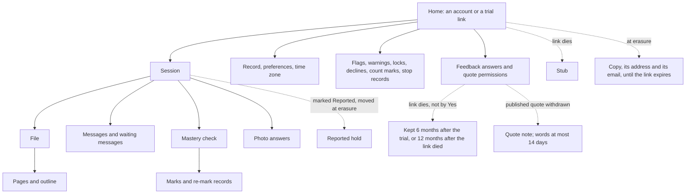
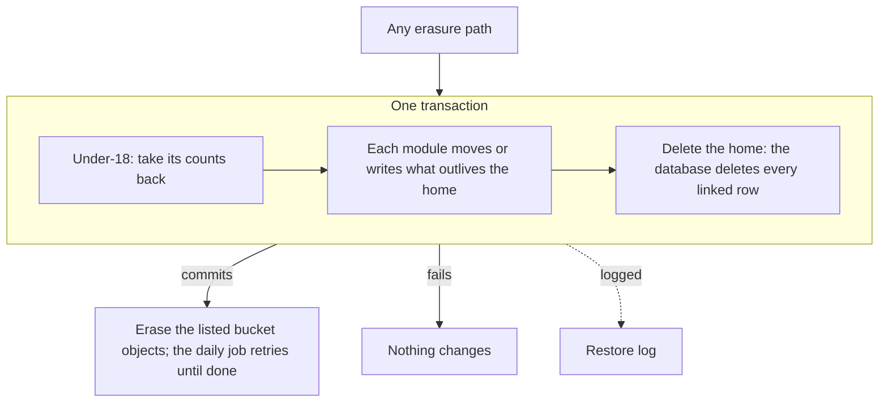

# The data model

**Draft: not locked.** Part of the [Crux v1 spec](README.md). Terms are as [`GLOSSARY.md`](../../GLOSSARY.md) defines them.

This file covers what Crux stores, what each item belongs to, where it lives, which module writes it, and how erasing a home works. It names no tables, columns or types: build tickets pick those ([#719]). An item's lifetime is set by the area file linked in its line. This file states a lifetime only where no area file sets one ([#719]).

## Homes

- A learner's data belongs to a home: an account or a trial link. Every learner item links to its home, directly or through its parent ([#719]).
- What only an account has (its email, sign-in codes, the 7-day undo, copies) sits on the account. What only a trial link has (its scrambled key, browsers, switched-off state) sits on the link ([#719]).
- A file belongs to its session. The storage allowance is still counted per home (see [`files.md`](files.md)) ([#719]).
- Guests have no home, and Crux stores nothing for them (see [Guests](#guests)) ([#719]).
- Row-level security keys on the home: the backend sets the home for each transaction ([#716], [#719]). The owner page, the daily job's scans and the sign-in lookups (an account by its email, a link by its key) read through rules that name what each may see. The owner page sees flagged and shared sessions, feedback, a Reported session's date, kind and email, and the dead-link list. Two roles pass row-level security, both used only by the release script: the read-only dump role, and the restore's role, which writes for a restore or a repair (see [`hosting.md`](hosting.md)) ([#719]).

## What belongs to what

Solid lines are delete with parent: deleting the parent deletes the child in the same transaction. Dotted lines are items moved or written outside the home before it is erased ([#719]).

## Stored items

"DB" is Crux's Postgres database. "Bucket" is the files bucket in Cloud Storage. Each line names its module (see [Modules](#modules)).

### In a session

All are in the DB unless marked, and go with their session ([#719]).

| Items | Module | Lifetime |
|---|---|---|
| The session, its name, last-visit order, request, goal and level answers, jump points, resume point and step state | Learning | [`sessions.md`](sessions.md) |
| Messages, Crux's fixed lines, blocked-message markers and "couldn't answer" lines; each turn's idempotency key | Learning | [`sessions.md`](sessions.md), [`ai-layer.md`](ai-layer.md) |
| Waiting messages, messages kept while the tutor is off or a file is read, and claims on them | Learning | [`spending.md`](spending.md), [`live-faults.md`](live-faults.md), [`hosting.md`](hosting.md) |
| Topics, queued, paused and replaced topics, last-worked-on times, learning objectives and their status, trouble marks, missed-problem counts, dropped objectives and their offer, pass dates, mastered topics, menu sources, offers for passes from other sessions | Learning | [`teaching.md`](teaching.md), [`learning-loop.md`](learning-loop.md), [`sessions.md`](sessions.md) |
| Mastery checks, problems and model answers, typed answers, marks, half-done checks, pause state, swap counts, disputes, complexity judgements | Mastery check | [`mastery-check.md`](mastery-check.md) |
| Re-mark records, the "re-marked as correct" note, undone passes waiting for a check, pending re-mark notices | Mastery check | [`live-faults.md`](live-faults.md) |
| Photo answers (bucket) | Files | [`mastery-check.md`](mastery-check.md), [`files.md`](files.md) |
| Files and their pages (bucket); each file's outline, state, harmful-file hold, file mistake flags and added page ranges (DB) | Files | [`files.md`](files.md) |
| A sealed session's seal and flag number | Safety | [`misuse.md`](misuse.md) |

The "Couldn't read this file" line belongs to the session, not the file, so it outlives the file until dismissed ([`files.md`](files.md)) ([#719]).

### In a home, across sessions

In the DB, and erased with the home ([#719]).

| Items | Module | Lifetime |
|---|---|---|
| The record, preferences | Learning | [`sessions.md`](sessions.md), [`teaching.md`](teaching.md) |
| The time zone: the browser sends it with each request, and the home keeps the latest | Homes | With the home ([#719]) |
| Spend for the current day and week, the near-limit pop-up shown | Spending | [`spending.md`](spending.md), [`privacy.md`](privacy.md) |
| A stop record per day: kept until the daily email covering that day is sent, then only nameless totals | Spending | [#719] |
| The age question's open state | Safety | [`age.md`](age.md) |
| Decline records, the open flag, a warning, the block count, a lock and its end, a misuse closure and contest, re-marks waiting on a seal | Safety | [`misuse.md`](misuse.md) |
| Feedback answers, sends per day, quote and share ticks, the "email me" tick, the first-mastery notice shown, unread marks | Feedback | [`feedback.md`](feedback.md) |
| Count marks: they go when the account is erased, not when it closes | Feedback | [`feedback.md`](feedback.md) |

A decline in a sealed flag stays with its sealed session and goes with it, not when the message naming it is sent. Once the seal is lifted, [`misuse.md`](misuse.md)'s rule applies, with the lift's message as the message naming it ([#719]).

### Account only

| Items | Module | Lifetime |
|---|---|---|
| The account and its email, sign-up ticks, terms agreement and pending terms step, last visit and idle warnings, closing state | Homes | [`accounts.md`](accounts.md), [`privacy.md`](privacy.md) |
| Sign-in codes; code limits per email and per network address | Sign-in | [`accounts.md`](accounts.md) |
| "Email me when it's back" address | Spending | [`spending.md`](spending.md) |

### Trial link only

| Items | Module | Lifetime |
|---|---|---|
| The link and its scrambled key, browser IDs, unseen notices, the device note shown | Homes | [`trial.md`](trial.md) |
| Wrong-link counts per network address | Sign-in | [`trial.md`](trial.md) |

Sign-in sessions belong to the Sign-in module, for accounts and links, behind the sign-in cookie ([`accounts.md`](accounts.md)).

### Guests

A guest's data is held in their browser, never by Crux ([#719]):

- The tab holds the conversation and sends it with each reply. Crux signs it, and refuses one that comes back changed.
- The browser holds the random ID and the 10-reply count, signed. Clearing or restoring browser data can reset the count. The guest cap bounds what that can spend (see [`trial.md`](trial.md)).
- Entry ticks are held in the browser and signed, for guests and trial-link users alike, so they stay "once per browser".
- The model answers and marks of a mini check are held in the tab encrypted, so only Crux can read them, until the result is shown.
- A conversation holding a prohibited-content block or a Yes to the age question gets no further replies.
- A resent older state is accepted for the reply count, the block and the age rules, since a new tab allows the same. So a guest's mini check gets no allowance past the caps: it stops at them like any guest reply (see [`trial.md`](trial.md)).
- A guest's time zone is used for the request and not kept.

### Outliving a home

These never link to a home with delete with parent. The erasure writes or moves them first ([#719]):

| Item | Module | Lifetime |
|---|---|---|
| The reported hold: a sealed session marked "Reported", with its files, its flag's date, kind and number, and for an account its email. Nobody can open the session. The owner sees the date, the kind and the email | Safety | Until the owner erases it ([`misuse.md`](misuse.md)) |
| A dead link's stub: its scrambled key, its scrambled sign-in cookie IDs, its state and, for a link switched off, the reason. A link that died by a Yes keeps only "ended" | Homes | The trial's end, or 12 months after the link died, whichever comes first ([`trial.md`](trial.md)) |
| A dead link's feedback answers and quote permissions, when it died other than by a Yes | Feedback | 6 months after the trial ends, or 12 months after the link died, whichever comes first. A published quote's answer stays until the owner marks it removed ([`feedback.md`](feedback.md)) |
| A published quote's note and remove-by date, and after an ending other than an under-18 one, its words | Feedback | [`feedback.md`](feedback.md) |
| Anonymous feedback tallies | Feedback | [`feedback.md`](feedback.md) |
| A copy (copies bucket), its address, its link's scrambled code, and the email that sends its link | Homes | Until its link expires ([`privacy.md`](privacy.md)) ([#762]) |
| The scrambled misuse email | Safety | 12 months ([`misuse.md`](misuse.md)) |
| The list of a home's bucket objects to erase | Files | Until each is erased; the daily job retries ([#719]) |

### Crux-wide

In the DB unless marked. None belongs to a learner ([#719]).

| Items | Module | Lifetime |
|---|---|---|
| Nameless counts: arrivals, path counts, the dated under-18 count, refused codes, accounts ever made, the go-public window and its turn-away days | Feedback, Sign-in | For the life of Crux v1 ([#719]) |
| "Told Crux is full": a scrambled email per day, on both sign-in paths | Sign-in | That day only: a Cloud Tasks job deletes it at the end of the owner's day, and the daily job sweeps any it missed ([#719]) |
| Trial turned-away counts | Spending | [`spending.md`](spending.md) |
| The month's, today's, the guests' daily and monthly, the owner's share and the distress check's spend; nameless totals; re-run budget state; alert markers | Spending | [`spending.md`](spending.md) |
| Owner-page settings and switch states | Owning module; switches: Operations | Until changed ([`live-faults.md`](live-faults.md)) |
| Let-in entries and their notes, the owner's own email list, "email me if spots open" addresses | Sign-in | [`accounts.md`](accounts.md) |
| Waiting access requests, invites and declines waiting to send, the trial end date | Sign-in, Homes | [`trial.md`](trial.md) |
| The email queue with each kind, sender counts, required emails' acceptance times | Email | [`operations.md`](operations.md) |
| Re-mark runs, the planted-file re-check list | Mastery check | [`live-faults.md`](live-faults.md) |
| Data requests entered on the owner page, daily email items, the daily job's last run | Operations | [`operations.md`](operations.md) |
| Terms versions and their "What changed" lists | Homes | For the life of Crux v1 ([#719]) |

### Outside the database

| Item | Place | Lifetime |
|---|---|---|
| Dumps | Their own bucket | [`hosting.md`](hosting.md) |
| The restore log | Its own Cloud Storage bucket, soft delete off. The app can only add entries, and only the release script reads them | A lifecycle rule deletes each entry after 8 days ([#719]) |
| Request logs, error reports, lookup and push log lines | Google's logs | 30 days ([`hosting.md`](hosting.md)) |
| Billing export | BigQuery | [`operations.md`](operations.md) |
| Background answers and short-lived expiry jobs | Cloud Tasks | Until they run ([`hosting.md`](hosting.md)) |
| Private source maps, each AI test's last passing round | Build and test records; the build ticket picks the place | [#719] |

Not stored: the note, which Crux builds on each reply from its records ([`sessions.md`](sessions.md)) ([#719]).

## Erasing a home

- One erasure routine erases a home, and every path calls it: closing after the undo, an under-18 Yes, the idle rule, a misuse closure, a link dying, Crux closing, a paid launch's non-answer, and a deletion request by email. The Homes module runs it, and each item's own module makes its move or write ([#719]).
- Before the transaction, the routine makes any copy asked for and records it, or reuses one already recorded ([#719]).
- In one transaction: for an under-18 closure, take its counts and feedback tallies back and add 1 to the dated under-18 count; make every move and write in [Outliving a home](#outliving-a-home); add the home's stop records and today's spend to the nameless totals; list the home's bucket objects to erase, after the moves, by what each belongs to, never by folder; and delete the home. If any step fails, nothing changes ([#719]).
- After it commits, the listed bucket objects are erased. The daily job retries any still listed, and erases any copy object with no record ([#719]).
- A cost that arrives later for an erased home is added to the nameless month and day totals ([#719]).
- The move to the reported hold changes the owner of every row under the session, so delete with parent does not reach them. Until erasure the learner sees no change ([#719]).
- An under-18 closure erases an outstanding copy and its link. Crux then keeps nothing about the person, apart from a Reported session, its flag's record and its email ([`age.md`](age.md)) ([#719]).
- The restore log records each home erasure, with any copy's object ID, expiry and scrambled code ([#762]). A restore re-applies it by calling the routine, so the moves and writes happen again before the delete. A replay rewrites a copy's record from the log, and makes and sends nothing. A replayed age answer calls the routine only, so the dated count gains 1 once (see [`hosting.md`](hosting.md)) ([#719]).
- Tests: every table holding a learner's data, apart from those in [Outliving a home](#outliving-a-home), links to a home with delete with parent; each item that outlives a home has its own erasure test; and erasing a home holding a Reported session, by each path and after a restore, keeps that session, its files, its flag's record and, for an account, its email ([#719]).

## Modules

The backend splits by area. Only an item's module writes it. The one exception is delete with parent, where the database deletes rows under links each module declares ([#719]).

| Module | Its job | Calls |
|---|---|---|
| Homes | Accounts and trial links, closing and the undo, copies, stubs, and the erasure routine | Every module with items in a home, for erasure; Email |
| Sign-in | Codes, sign-in sessions and their limits, access requests, the let-in list and the learner cap | Homes, Email |
| Learning | The learning loop and teaching: sessions, topics, objectives, the record, preferences, waiting messages, lookups | Tutor AI, Mastery check, Files, Spending, Safety, Feedback |
| Mastery check | Checks, marking, disputes and re-marks | Tutor AI, Spending, Learning, Feedback, Email |
| Files | Files, pages, outlines, photo answers, conversion | Tutor AI, Spending, Safety |
| Tutor AI | Every model call, the conversation format, prompts and tool calls. It owns no learner items | None in Crux |
| Spending | The budget, the ceiling, the limits and caps, and every spend record | Email |
| Safety | Declines, flags, warnings, locks, seals, the reported hold, misuse blocks, the age question's outcomes | Homes, Learning, Email |
| Feedback | Answers, quotes, shares, path counts and marks, the go-public window, arrivals, the dated under-18 count | None in Crux |
| Email | The email queue and sender shares | None in Crux |
| Operations | The daily job, switches, the restore log, dumps, health checks and the error log | Every module's housekeeping; Email |

- The owner page is not a module. Its screens call the modules, and each setting belongs to its module ([#719]).
- The tasks service runs the same code, so a module's background work sits in that module (see [`hosting.md`](hosting.md)) ([#716], [#719]).
- This covers the backend. Frontend modules follow the screens (see the main file's Gaps) ([#719]).

[#716]: https://github.com/calmxz/Crux/issues/716
[#719]: https://github.com/calmxz/Crux/issues/719
[#762]: https://github.com/calmxz/Crux/issues/762
