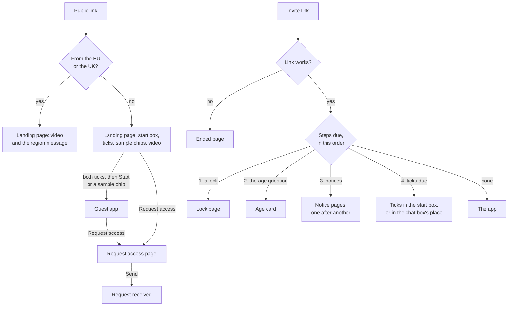

# The landing page, guest mode and trial links on screen

**Draft: not locked.** Part of the [Crux v1 spec](README.md). Terms are as [`GLOSSARY.md`](../../GLOSSARY.md) defines them.

This file covers what a visitor sees before having an account: the landing page, guest mode, Request access, "Who runs Crux", and a trial link's entry, notices and endings. All of it comes from [#754] unless a line says otherwise. The rules these screens show are in [`trial.md`](trial.md), [`age.md`](age.md), [`accounts.md`](accounts.md), [`privacy.md`](privacy.md), [`spending.md`](spending.md), [`misuse.md`](misuse.md) and [`hosting.md`](hosting.md). The session screen, the app shell, the sign-in page and the opening page are in [`learning-screen.md`](learning-screen.md), [`app-shell.md`](app-shell.md) and [`account-screens.md`](account-screens.md). The prototype the owner chose from is on the throwaway branch `prototype/754-landing-guest-trial`: the landing page is variant B, and the other screens mix the variants as this file says.

## The landing page

- One screen, led by the guest's own-topic start box, "What do you want to learn? Type a topic", with the limit line under it. Under that, "Or try a sample topic, about 10 minutes, with a 2-problem check at the end:" and the sample topics as chips. Beside the box on desktop, under it on a phone: the demo video and the 18+ line, "Crux is for adults (18+)".
- The headline and the line under it are written at build.
- The two entry ticks sit inside the start box from the outset. Start and the sample chips work only once both are ticked. Typing in the box works before.
- Further down the page: a Request access section, "Your own trial link: saved sessions, your own files and photo answers.", with a button that opens the Request access page. Then the footer: the Trial Terms, Privacy Notice and "Who runs Crux" links.
- The top bar holds Request access. There is no "Sign in" during the trial (see [Signing in during the trial](#signing-in-during-the-trial)).
- Request access shows, on this page and in guest mode, only while the trial runs (see [`trial.md`](trial.md)).
- **From the EU or the UK:** the video and the region message, "Crux isn't available in your region yet.", in place of the start box and the chips, with no Request access.
- **Before typing, when guest mode is full or paused:** the stop line takes the start box's place. The video and Request access stay.
- **While the backend wakes,** Start shows "Starting the tutor…" until the first reply. **When it can't be reached,** the start box and Request access are greyed, with "Crux can't be reached right now. Try again in a few minutes."
- **After the trial,** if Crux stays a portfolio project: the same page with no Request access.
- **From opening:** the pre-written example in the start box's place, with "Sign in or sign up" in the top bar and under the example. The video stays beside it.
- **An unknown address** shows "This page doesn't exist." with "Go to Crux".

## Guest mode

- A guest works in the **guest app**: the app shell from [`app-shell.md`](app-shell.md) with the guest's own sidebar, and the session screen from [`learning-screen.md`](learning-screen.md).
- The sidebar (the drawer on a phone) holds "Your topic", with the guest's session and "This tab only" under its name; then "Sample topics"; and at its foot Request access, with "Your own trial link: saved sessions, your own files and photo answers.", then the Trial Terms, Privacy Notice and "Who runs Crux" links. It has no "What you've mastered", Feedback, Settings or "+ New session".
- On the guest's own topic, the top bar shows the replies left all along: "7 of 10 replies left". A sample topic has no count.
- At the 10th reply, "That's the end of guest mode for your own topic" shows in the thread, with a button for each sample topic and Request access. The chat box gives way to "Your own topic has used its 10 replies."
- A sample topic's mini check uses the check bar, reading "Mini check · Problem 1 of 2 · closed book", with no Photo button.
- After a sample's result card, Crux's own fixed line, with no AI call: "That's the sample. Try another, try your own topic, or ask for a trial link.", with those three buttons. Once the own topic's 10 replies are used, the line and its buttons leave out the own topic: "That's the sample. Try another, or ask for a trial link." After the trial, they leave out the trial link. A sample has no after-mastery menu.
- An upload gets the pinned line "Uploading your own files needs a trial link." with Request access, as [`app-shell.md`](app-shell.md) places refused uploads.
- **When Google blocks a guest's message as prohibited content,** the session ends in place. The thread stays, with a red line, "The tutor can't help with this, so this guest session has ended.", and the chat box gives way to "This guest session has ended." with "Back to the start", which opens the landing page. The replies left stay with the browser.
- **After Yes to the age question,** the tab goes back to the landing page, with no message, and the ticks show again in the start box.

### Guest stops

- **Mid-conversation,** the stop line shows in the thread, then the video, and the chat box gives way to the stop line. If the stop caught a message and the distress check answers yes, the care line and the crisis line follow the stop line.
- A mini check stopped at the caps stays in the tab. Sending again after the reset carries on, if the tab is still open.
- A mini check dropped at Google's cap, by the guest-mode switch or while checks are switched off shows "Your mini check was dropped." under the stop line.
- The guest-mode switch's line reads "Guest mode is paused while we fix something.", in the thread, or in the start box's place before typing, with the video (see [`live-faults.md`](live-faults.md)).

## Request access

- A page of its own, holding one card, like the sign-in page: the spec's line, the email, the human check, "I am 18 or over", and Send request. It is the same page from the landing page, the guest sidebar, the 10-reply line, the upload line and a sample's end line.
- After Send, the card reads "Request received", "If you're approved, we'll email you a private link. Check your spam folder too." and "We keep your email only until we approve or decline your request, at most 30 days.", with "Back to Crux", which returns to where the visitor came from. A guest's conversation stays in its tab.
- The region message shows under Send.
- The invite email's subject is "Your Crux trial link", and the decline's "About your Crux request".

## Who runs Crux

- A page of its own, holding one card, the same from every link: the landing page's footer, the guest sidebar, and a trial link's Settings among the trial's terms links.
- During the trial, it reads "Crux is built by [the owner's name], in the Philippines.", then privacy@ for questions about your data or having it deleted, and the owner's LinkedIn for anything else. From opening, it carries the officer's details (see [`privacy.md`](privacy.md)).

## Signing in during the trial

- The landing page has no "Sign in" during the trial. The owner reaches the sign-in page by its own address.
- An email not on the owner's list, by code or by Google, gets this under the button tapped, and no code is sent: "Sign-up isn't open yet. To try Crux, use guest mode or ask for a trial link.", with Request access. From the EU or the UK, the region message shows in its place (see [`accounts.md`](accounts.md)).
- From opening, the landing page shows "Sign in or sign up", and the refusal goes.

## Trial links

- **First open on a browser:** the app opens as [`app-shell.md`](app-shell.md) says. The entry ticks sit inside the start box, under "Welcome to your trial." and the trial link notice. When the app opens on a session, because the link already has sessions, they take the chat box's place. Start or Send works once both are ticked.
- **The Trial Terms change:** the ticks show again in the same place, under "The Trial Terms changed on 2 Dec. What changed".
- **The one-time device note** is a banner across the top of the app, with Dismiss.
- **The sidebar's foot** reads "Trial link" where an account shows its email. Settings has no Account part (see [`account-screens.md`](account-screens.md)).
- **On opening, in this order:** a lock, the age question, any notice pages, then the ticks if due. This mirrors an account's order, where the age card comes before the Keep and terms pages.
- **A locked link:** the lock page from [`account-screens.md`](account-screens.md), headed "Your trial link is locked", with "Read my sessions" and no Sign out.

### Notice pages

Each is an opening page with Continue. Several show one after another, before the app. Each shows once per link.

- **The trial is ending:** "The trial ends on 15 Jan", then "After that, this link stops working and everything in it is erased. Until then, you can untick a quote or a share in Settings, under Your feedback."
- **A data breach:** "A data breach", then what happened, written at the time.
- **A misuse flag dismissed:** "Crux's owner read some of your sessions", then the dismissal's wording from [`misuse.md`](misuse.md).
- A re-mark's notice stays a line in the thread (see [`learning-screen.md`](learning-screen.md)).

### Ended pages

A link that no longer works opens an opening page in place of the app, saying why:

| When | Card |
|---|---|
| Switched off by the owner | "This trial link was switched off", the owner's reason, and "Its sessions have been erased.", with Request access |
| Switched off for misuse | "This trial link was switched off", then "The tutor declined 3 of your requests (making drugs or other illegal goods), and the owner read those sessions. The owner switched this link off, and its sessions have been erased.", with Request access |
| Just after Yes to the age question | "Your trial has ended", then "Crux is for people 18 and over, so this trial link has been switched off and its sessions have been erased.", with OK, which goes to the landing page |
| Back later on a link ended by a Yes | "This trial link has ended", then "It no longer works.", with OK |
| A link Crux doesn't know | "This link doesn't work", then "Open the whole link from your invite email. If it still doesn't work, you can request access again.", with Request access |
| 10 wrong links from one network in an hour | "Too many wrong links", then "Your network tried too many links that don't work. Try again in an hour." |
| The trial is over | "The trial has ended", then "Thanks for trying Crux. You can still try it as a guest.", with "Try it as a guest". From opening: "Thanks for trying Crux.", with "Sign in or sign up" |

Request access shows on these pages only while the trial runs.

## Frontend modules

| Module | What it holds |
|---|---|
| Landing page | The start box with the ticks, the chips, the video, the 18+ line, the Request access section, the region, wake, unreachable, stopped and opening states, "Who runs Crux" and the page-not-found page |
| Entry ticks | The two ticks and the trial link notice, in the start box or the chat box's place, held once per browser |
| Guest mode | The guest sidebar, the reply count, the 10-reply line, the sample's end line, the guest stops and the block ending |
| Request access | The Request access page and its received and region states |
| Trial link | The device banner, the notice pages, the ended pages, the locked link's wording, and the opening order |

The app shell gains the guest sidebar. The session screen gains the reply count and the mini check's bar.

[#754]: https://github.com/calmxz/Crux/issues/754
