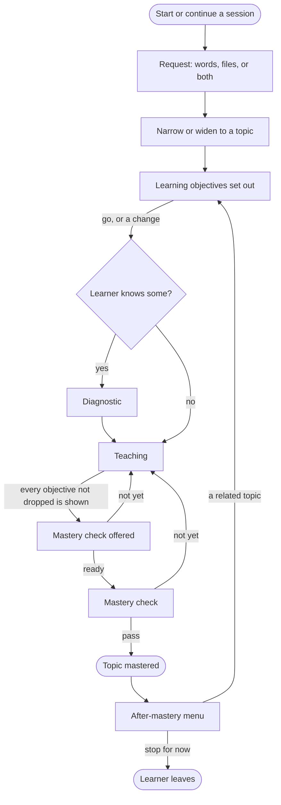

# The learning loop

**Draft: not locked.** Part of the [Crux v1 spec](README.md). Terms are as [`GLOSSARY.md`](../../GLOSSARY.md) defines them.

This file covers the loop from request to after mastery. That is requests and narrowing, topics and their learning objectives, changes to them, and the after-mastery menu. How the tutor teaches is in [`teaching.md`](teaching.md). The check itself is in [`mastery-check.md`](mastery-check.md).

## The loop

- The loop runs as drawn. A prerequisite topic pauses the current topic inside it (see [`teaching.md`](teaching.md)) ([#664], [#668], [#670]).
- The loop starts after sign-in. Before Crux opens, a guest or a trial-link holder enters it without an account (see [`accounts.md`](accounts.md) and [`trial.md`](trial.md)) ([#674], [#677], [#722]).
- The learner can leave at any step and resume the session at the step they left. What the tutor does on return is in [`sessions.md`](sessions.md) ([#664], [#671]).
- At any step, a learner who says they are under 18 gets the age question (see [`age.md`](age.md)) ([#681]).

## Requests

- A request is the learner's typed words, files, or both. The session keeps it as what the learner came for. It has no mastery and no plan ([#662], [#665], [#667]). How files shape a topic is in [`files.md`](files.md).
- The levels are request, topic and learning objective. Only topics and objectives count toward mastery. Nothing is tracked below an objective ([#665]).
- A topic's mastery must be something the learner can show in writing in the chat ([#665]).

| Request | What the tutor does |
|---|---|
| Topic-sized | Goes straight to the objectives ([#665]). |
| Too broad, or a goal ("pass my exam Friday") | Asks goal and level, unless the request already shows them, then offers topic options. Deadlines are not tracked ([#665], [#666]). |
| Two topics named | Too broad: one goes first, and the other is queued ([#665]). |
| An exam with a named weak part | Goes straight to that topic, with no options. The exam's other topics come later, on the menu ([#666], [#670]). |
| Unsure ("idk, something in math") | Asks goal and level, then offers topic options from different areas, with "name an area" as the way out. There is no separate area step ([#666]). |
| Too narrow (a single problem) | Widens it to the smallest topic that contains it ([#665]). |
| Ambiguous | See [Ambiguous requests](#ambiguous-requests). |
| Not showable in writing | Turns a physical skill toward its knowledge part, and a task toward the skill behind it. The tutor says what the check will and will not cover. Trivia with nothing to turn toward gets "what would you like to learn?" ([#665]). |
| Harmful | Declined. Harm is as the Terms of Use define it (see [`misuse.md`](misuse.md)) ([#665], [#677]). A harmful file also holds the session until it is removed (see [`files.md`](files.md)) ([#732]). |

### Narrowing

- Each step asks everything in one message: goal and level together, then the options, then the objectives ([#666]).
- Unsure of goal or level, the tutor states an assumption ("I'll assume you're starting fresh") and carries on, rather than asking again ([#666]).
- Learner replies before teaching starts ([#666]):
  - 1 for a clear topic-sized request or a single problem.
  - 2 for an ambiguous first message, or an exam with a named weak part.
  - 3 for a broad, unsure or turned request.
- Narrowing does not quiz prerequisites first ([#665]).
- Replies are typed ("1", "you pick", "go", anything). There are no quick-reply buttons ([#666]).
- The final wording of six sample exchanges is in #666's details block. Its sin(x²) sample is out of date: the tutor now teaches on a twin ([#666], [#667]).

### Topic options

- Options are always topic-sized: 3 to 5, as many as the request has good starting points. They are numbered, each with a one-line hook ([#665], [#666]).
- The best fit is marked up front, with its reason. Every options message ends "pick a number, name your own, or say 'you pick'". "You pick" takes the marked option ([#666]).
- If the learner still cannot choose, the tutor picks the best fit and says why ([#665]).
- For an unsure request, the options are the common starting points of each area at the learner's level, not niche picks. They come from the tutor's own knowledge, with no web search in v1 ([#666], [#679]).
- A turned request asks goal and level in the same message as the turn. Its options say what the mastery check covers ([#666]).

### Ambiguous requests

- With nothing to go on, such as an ambiguous first message, the tutor asks which meaning. The meanings are numbered, with no pick marked ([#665], [#666]).
- When the conversation points one way, the tutor states its guess at the top of the objectives message: "I'll take this as the chain rule in calculus, since we've been working on derivatives. If you meant the chain rule in probability, say 'probability'." ([#666])
- The learner's mastered topics, from any session, count as something to go on. If they and the conversation disagree, the conversation wins, and the other meaning is still offered at the top of the objectives message ([#671]).

### A single problem

- The widening, the objectives and the chance to decline come in one message, ending "Say 'go' to start with a problem like yours". The tutor teaches on a twin (see [`teaching.md`](teaching.md)) ([#666], [#667]).
- Crux gives no bare answers. If the learner declines the widened topic, the tutor asks what they would like to learn ([#665]).
- "Just give me the answer" gets "Crux doesn't hand out answers; it teaches you how to get them. Is there something you'd like to learn instead? It can be anything." ([#666])

## Topics and learning objectives

- A topic is usually 3 to 5 learning objectives, finished in one or two study blocks. "Calculus" and "derivatives" are too broad; "the chain rule" is a topic ([#665], [#667]).
- 5 is the most. An objective added past 5 becomes the next topic, queued ([#665]).
- A topic has fewer than 3 only by the learner's choice. Either a file covers it too thinly and they want nothing added (see [`files.md`](files.md)), or they decline a replacement for a drop ([#667], [#668]).
- The tutor drafts the objectives, in the files' order where there are files, otherwise in teaching order. It teaches them top to bottom without asking ([#665], [#668]).
- Teaching waits for the reply to the objectives message: "go", "I know some of this" (the diagnostic, see [`teaching.md`](teaching.md)), or a change ([#666]).
- The topic's name follows its objectives ("the chain rule for polynomials"). The name narrows when an objective is dropped, and returns when it is added back ([#665], [#668]).

### Changes before the check

- Until the mastery check starts, the learner can ask in the chat to add, drop or reword objectives, within the topic. Never during a check ([#665], [#728]).
- A drop asked for in the chat gets "why?". If the reason is difficulty, the tutor offers help first, and the learner decides ([#665]). A drop from the never-ready menu follows [`teaching.md`](teaching.md) ([#668]).
- Dropping the topic's core makes it a switch (see [Switching topic mid-way](#switching-topic-mid-way)) ([#665]).
- A drop that leaves fewer than 3 objectives gets one offer of a close replacement objective, within the topic. From the never-ready menu, the offer follows the drop. Declined, the topic keeps 1 or 2, its name narrows, and the check covers what is left ([#668], [#669], [#731]).
- The last objective cannot be dropped. Leaving it means stopping, or a new topic ([#668]).
- A dropped objective stays listed as dropped. It is not taught or checked. Before the check, the learner can pick it back up: it returns to in progress, and the name returns ([#668]).

### A mastered topic is fixed

- Once a topic is mastered, the learner cannot add, drop or reword its objectives. An addition or rewording asked for after mastery, at any time, becomes the next topic, queued ([#665], [#728]).
- One way back in is a dropped objective, through its offer on the menu or when the learner asks for it. It rejoins the topic, is taught, and is checked on its own ([#668], [#670], [#728]).
- A pass restores the topic's full name and shows the menu again, without the dropped line if none are left. A fail goes back to teaching that objective under the check's rules; the smaller topic stays mastered. Dropping it again returns to the menu ([#670]). A re-mark that undoes that pass works the same way ([#736]).
- The other way back in is a re-mark that undoes a pass. That objective is checked again on its own, whenever the learner chooses, or dropped as after a fail. A dropped failed objective that a re-mark finds right rejoins the topic, and restores its full name (see [`live-faults.md`](live-faults.md)) ([#736]).

## Switching topic mid-way

- When the learner asks for a different topic before the current one is mastered, related or not, the tutor suggests a new session. The current session waits where it stopped. The tutor never judges relatedness mid-topic ([#665]).
- Declined, the tutor warns that the current topic will be left unfinished, and that coming back means starting it again. Then the new topic replaces it in this session ([#665]).
- The replaced topic joins the queued topics, so it comes first on the menu ("the chain rule (starting again)"). Started again, the diagnostic skips what the learner had shown. Objectives passed in its own check stay passed, not checked again ([#665], [#670], [#671], [#732]).
- Three exceptions are learned in the same session, with the current topic paused. A prerequisite topic the learner agrees to learn (see [`teaching.md`](teaching.md)). A mastered topic's dropped objective, asked for mid-topic: it is taught and checked, then the paused topic resumes ([#668], [#670]). An objective a re-mark undid: it is checked, then the paused topic resumes ([#736]).
- A file given later on another topic follows [`files.md`](files.md) ([#667]).

## After mastery

### The menu

- At mastery, the tutor shows a short numbered menu: 2 or 3 related topics with the tutor's pick marked, then "Stop for now". The learner replies with a number, or types something else ([#670]).
- Topics come from these sources, in this fixed order ([#670]):
  1. Named or queued topics.
  2. The next parts of the files ("Next in your slides: the chain rule (slides 28-36)").
  3. The next step the request points to. On an exam request, the exam's other topics, unless already named or in the files.
  4. A neighbour of the topic just mastered.
- The tutor proposes topics tagged with their source. Crux sorts them in that order and keeps 2 or 3 (see the main file's "Crux decides") ([#679]).
- The tutor's own knowledge can always supply sources 3 and 4, so the menu never has fewer than 2 topics. The pick is the first in the order ([#670]).
- The menu skips topics already mastered in another session, except a named or queued one, shown marked: "Related rates (you mastered this in physics on 14 Jan)". Typed anyway, such a topic follows [`sessions.md`](sessions.md) ([#671]).
- After a topic unrelated to the request and files, the 2 or 3 topics come from it: its next step and its neighbours. One more line, not counted in the 2 or 3, leads back: "Back to derivatives: implicit differentiation (slides 37-45)". It names the first topic in the request's own order, and picking it starts that topic. A topic replaced mid-way comes first there: "Back to derivatives: the chain rule (starting again)" ([#670]).
- The skip leaves the "Back to" line and the dropped line alone ([#671]).
- The same menu follows every route to mastery: a check passed, a dispute won while back in teaching, a re-added objective's check passed, or a failed objective dropped. After a dispute win, teaching stops: "No need to keep going over objective 3" ([#670]).
- A prerequisite topic's mastery has no menu (see [`teaching.md`](teaching.md)) ([#670]).
- There is no "up next" list during teaching. The learner can ask what comes next at any time. The choice is made at the menu ([#670]).

### Dropped objectives on the menu

- Objectives dropped from the topic just mastered get their own line, not counted in the 2 or 3: "Finish the chain rule: three-layer composites (you dropped this)". Several share one line ([#670]).
- Objectives dropped from a prerequisite topic go on the paused topic's menu, on the same line ("Pick up what you dropped: ...") ([#670]).
- Each dropped objective has one offer: the line on its topic's menu. It shows at mastery, and each time that menu is rebuilt after "Stop for now" ([#670], [#728]).
- The offer is used up when the learner picks anything from that menu. Only then does Crux record it as having had its one offer. Showing the line does not use it up ([#671], [#728]).
- After that, Crux never offers it on its own again. It stays listed as dropped on its topic, and the learner can ask for it at any time ([#670], [#728]).

### Everything covered

- When everything the learner came for is covered, the tutor says so once, at the mastery that completes it. The menu carries on: "That covers everything you came for: derivatives for your exam, all of your slides. Want to keep going?" ([#670])
- Covered means every part of what the request asked for has been taught. With files and no words narrowing them, every part of the files, except one the tutor declined (see [`files.md`](files.md)). With words that pick a part of the files, that part. With words only, the tutor's judgement ([#670]).
- File parts mastered in another session count as covered. A very broad request may never be covered ([#670], [#671]).

### The next topic

- A typed topic is related if the request or files cover it, or it builds directly on the topic just mastered. A related topic continues in the session, even along a chain ([#670]).
- An unrelated topic after mastery gets a new-session suggestion, which the learner can decline. Declined, it follows in this session with no warning, and the session keeps its request ([#670]).
- A menu-picked topic starts with its objectives and waits for "go", with no narrowing questions. At "go", the learner can change objectives or claim some ([#670]).
- A typed topic is first narrowed or widened if it is not topic-sized, then starts the same way ([#670]).
- The tutor teaches each topic as new unless the learner says otherwise ([#670]).

### Stopping and coming back

- "Stop for now" gets a one-line sign-off, with no recap: "Good work today. This session is saved; the menu will be here when you're back." ([#670])
- On return, the tutor welcomes the learner back, names the topic mastered last time, and shows the menu rebuilt in the same order. It can differ from the menu left if a topic was mastered in another session since ([#670], [#671]).

## Guest mode

- A guest's sample topic is a demo of one learning objective, with a 2-problem mini check. It is not a topic in the usual sense. It earns nothing and keeps nothing (see [`trial.md`](trial.md)) ([#677]).

## On screen

Layout is not decided (see the main file's Gaps). These rules need: the objectives message with each objective's status, the topic options, the after-mastery menu with its dropped line, and the welcome back ([#666], [#668], [#670]).

[#662]: https://github.com/calmxz/Crux/issues/662
[#664]: https://github.com/calmxz/Crux/issues/664
[#665]: https://github.com/calmxz/Crux/issues/665
[#666]: https://github.com/calmxz/Crux/issues/666
[#667]: https://github.com/calmxz/Crux/issues/667
[#668]: https://github.com/calmxz/Crux/issues/668
[#669]: https://github.com/calmxz/Crux/issues/669
[#670]: https://github.com/calmxz/Crux/issues/670
[#671]: https://github.com/calmxz/Crux/issues/671
[#674]: https://github.com/calmxz/Crux/issues/674
[#677]: https://github.com/calmxz/Crux/issues/677
[#679]: https://github.com/calmxz/Crux/issues/679
[#681]: https://github.com/calmxz/Crux/issues/681
[#722]: https://github.com/calmxz/Crux/issues/722
[#728]: https://github.com/calmxz/Crux/issues/728
[#731]: https://github.com/calmxz/Crux/issues/731
[#732]: https://github.com/calmxz/Crux/issues/732
[#736]: https://github.com/calmxz/Crux/issues/736
