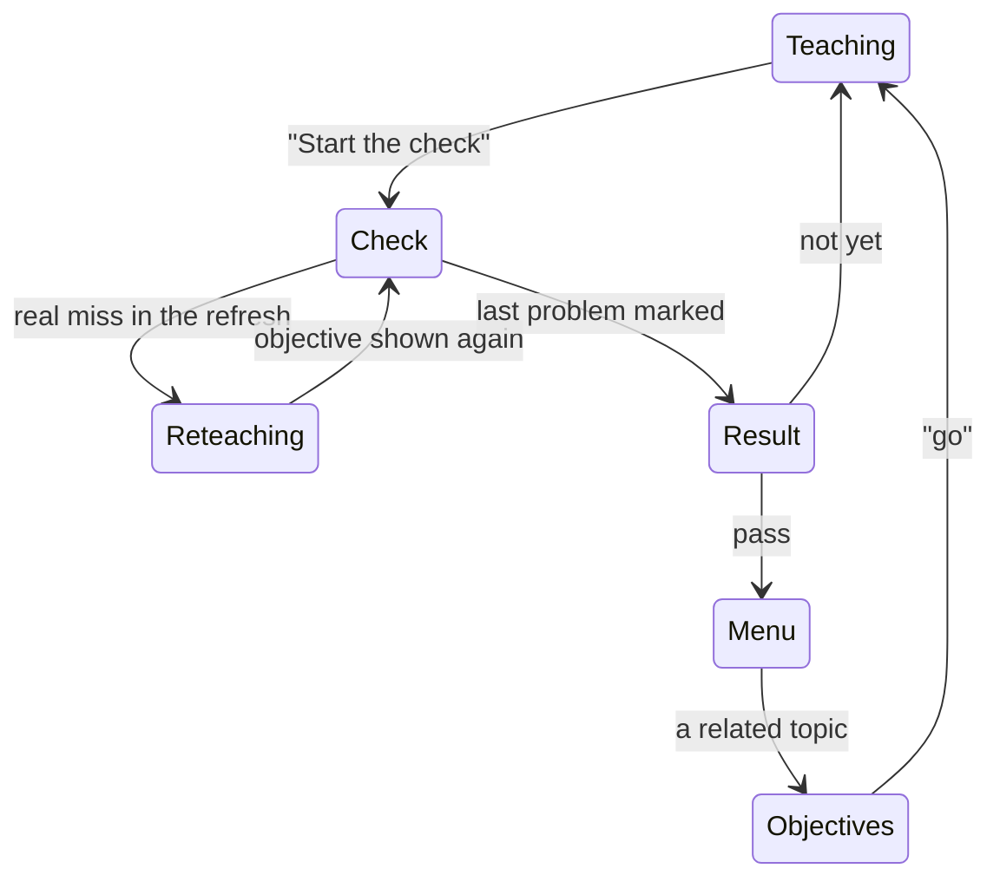

# The learning screen

**Draft: not locked.** Part of the [Crux v1 spec](README.md). Terms are as [`GLOSSARY.md`](../../GLOSSARY.md) defines them.

This file covers the session screen: where teaching, the mastery check, its result and Crux's own messages appear, and how pictures and mistake marks show. All of it comes from [#751] unless a line says otherwise. The rules these screens show are in the area files they link to. The prototype the owner chose from is on the throwaway branch `prototype/751-learning-screen`, variant A except where this file says otherwise.

## One screen

- A session is one screen: a top bar, the conversation, the chat box, and the objectives panel. The mastery check, its result and Crux's own lines all happen in that conversation, never on a separate screen.
- The screen's states:

## The objectives panel

- On desktop, a rail on the right of the conversation, always visible, except while the file viewer takes its place (see [`app-shell.md`](app-shell.md)) ([#752]).
- On a phone, a strip under the top bar: one coloured segment per objective, then the count of objectives shown or passed ("2 of 5 ▾"). A tap drops down the full panel. The count keeps the strip readable without colour.
- The panel holds:
  - the topic's name and the files it came from;
  - each objective with its status (see [`teaching.md`](teaching.md)), and the trouble mark as text ("needs 2 in a row");
  - a passed objective's date, and for one passed in another session, that session too, as a link: "passed in physics on 25 Nov" (see [`sessions.md`](sessions.md));
  - dropped objectives, struck through;
  - a paused topic;
  - the learner's preferences, each with a way to remove it;
  - "Mastered in this session", under the objectives: each topic mastered in the session, with its date and a link that opens its check's result. During a check its topics stay and its links hide, like jump points. A topic mastered twice shows both dates ([#752]);
  - the session's files, each with its state, any mistake mark (see [Mistake marks](#mistake-marks)), and × to remove it. Adding, reading and removing files are in [`app-shell.md`](app-shell.md) ([#752]).

## The mastery check

- When the check starts, the thread is cleared to the check alone. A dark check bar shows "Mastery check · Problem k of N · closed book".
- On desktop, the rail shows numbered progress dots at the top, and, in place of the files, "Files, earlier teaching and jump points are hidden until the result". The objectives, the paused topic and the preferences stay. On a phone, the check bar sits above the strip.
- Answers go in the chat box. A Photo button replaces the file button. Reminders, "Marking…" and the end step are messages in the thread, answered in the chat box.
- At the result, the files, the earlier teaching and the jump points come back. During reteaching after a refresh miss, they come back and hide again before the next problem (see [`mastery-check.md`](mastery-check.md)).

## The result

- The result is a card in the thread: pass or not yet, X of N, and a row per problem with its mark. A wrong problem shows its model answer, its missing point and Dispute in the card. A right problem's model answer is behind a tap.
- Tapping a problem opens a sheet over the conversation: the learner's own answer (typed, or the photo), the model answer, the missing point, and, for Dispute, a box to say where the answer covers the point.
- While checks are switched off, the sheet shows "You can dispute this when they're back." in place of the box (see [`live-faults.md`](live-faults.md)).
- The card stays in the thread. The sheet closes back to it.

## Menus and buttons

- The never-ready menu, the after-mastery menu and the quick-problem choice are tutor messages in the thread, answered by typing. The after-mastery menu's dropped-objective line and "Back to" line are extra lines under its numbered topics, set apart from them (see [`learning-loop.md`](learning-loop.md)).
- The buttons the spec names ("Start the check" and "Not yet", "Continue" and "Refresh first") sit under the tutor's message.

## Crux's own lines

- Crux's own lines are centred lines in the thread, coloured by kind (information, warning, stop, care), and stay in the conversation. They include:
  - the line after a filling reply, the limit messages and the month's tick-box (see [`spending.md`](spending.md));
  - the "paused" lines and the re-mark notices (see [`live-faults.md`](live-faults.md));
  - "The tutor is busy right now", the lines when Google blocks a reply, and the swap lines (see [`ai-layer.md`](ai-layer.md));
  - the care line at a limit, and the crisis line (see [`misuse.md`](misuse.md));
  - "please tap Yes or No" (see [`age.md`](age.md)), and "Your check is ready when you're back".
- A stopped message stays in the thread with its waiting mark. It is answered after the reset, or, when the tutor was switched off, by a tap (see [`spending.md`](spending.md) and [`live-faults.md`](live-faults.md)).
- The age question is a card in the thread of whichever session is open, with Yes and No. When no conversation is open, it shows in the main area (see [`app-shell.md`](app-shell.md)) ([#752]).
- The near-limit pop-up and the after-first-mastery notice are pinned lines above the chat box. Each shows once, as its own file says, and stays until dismissed or until the learner leaves. Neither shows inside a check; one due during a check waits until the result (see [`spending.md`](spending.md) and [`feedback.md`](feedback.md)).
- A held session's pinned line cannot be dismissed, and goes when its file is removed. Pinned lines stack with that line first, then in the order they came (see [`app-shell.md`](app-shell.md)) ([#752]).
- The near-limit pop-up and the care line at a limit have no wording yet. The build ticket drafts both for the owner.

## Pictures

- A diagram or graph shows inside the tutor's message, with a caption. When and how the tutor draws is in [`teaching.md`](teaching.md); how Crux checks a picture is in [`ai-layer.md`](ai-layer.md).
- Diagrams are drawn from Mermaid text on the frontend. Graphs are drawn from the points SymPy works out; the drawing library is left to the build.

## Mistake marks

- An unchecked file mistake (see [`files.md`](files.md)) shows as a mistake mark on its file in the objectives panel, until the learner reports back. It is hidden during a check, with the files.
- The mark reads, for example: "**Slide 30 may have a mistake.** It shows 5(3x² + 1)⁴. A possible correction is 5(3x² + 1)⁴ · 6x, but it could be wrong too. Ask your teacher, then tell the tutor what they said."
- It has two links. "Tell the tutor what they said" starts a chat reply ("About slide 30: my teacher said ..."). "No one to ask, go with the correction" clears the mark in one tap.

## Frontend modules

| Module | What it holds |
|---|---|
| Session screen | The top bar, the conversation, the chat box and the panel, laid out for phone and desktop, and the switch into and out of the check |
| Conversation | Tutor and learner messages, Crux's own lines by kind, waiting marks, pinned lines, and the buttons and cards in the thread |
| Objectives panel | The rail and the strip, statuses, the trouble mark, passed links, dropped objectives, the paused topic, preferences, files and mistake marks |
| Mastery check | The check bar, progress, photo answers and "Marking…" |
| Result | The result card and the problem sheet with Dispute |
| Pictures | Drawing Mermaid diagrams and graphs |

The app shell, the session list, the Record, files and the file viewer are in [`app-shell.md`](app-shell.md) ([#752]). The other screens add their own modules.

[#751]: https://github.com/calmxz/Crux/issues/751
[#752]: https://github.com/calmxz/Crux/issues/752
