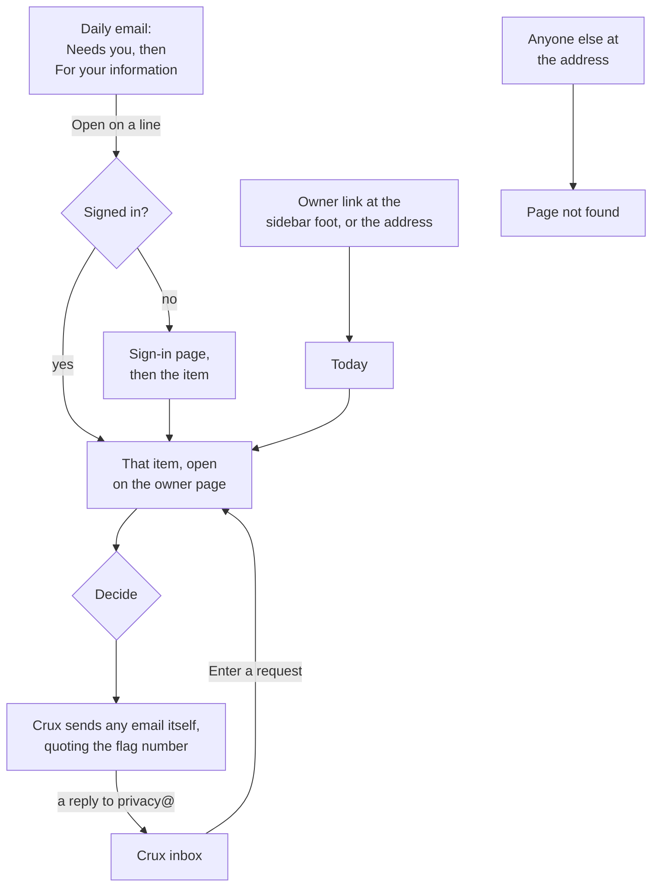

# The owner page and the daily email on screen

**Draft: not locked.** Part of the [Crux v1 spec](README.md). Terms are as [`GLOSSARY.md`](../../GLOSSARY.md) defines them.

This file covers what the owner sees: the owner page, its areas and dialogs, and the daily email's layout. All of it comes from [#755] unless a line says otherwise. The rules these screens show are in [`trial.md`](trial.md), [`misuse.md`](misuse.md), [`privacy.md`](privacy.md), [`feedback.md`](feedback.md), [`spending.md`](spending.md), [`accounts.md`](accounts.md), [`live-faults.md`](live-faults.md) and [`operations.md`](operations.md). The owner page is not a module: its screens call the modules, and each setting belongs to its module ([#719]).

## Reaching it

- The owner page is its own app, at its own address. "Owner" sits at the sidebar foot of the owner's own app, above Feedback and Settings, shown only to the owner's main address (see [`app-shell.md`](app-shell.md)).
- Anyone else at the address, signed in or not, test addresses included, gets the "Page not found" page an unknown address gets (see [`landing-screens.md`](landing-screens.md)). A signed-out owner gets it too.
- The daily email's links go through the sign-in page's own address, carrying the item as an opaque ID that survives Google's sign-in. A signed-in owner lands on the item; a signed-out owner signs in, then lands on it. Only owner-page items can be carried. Anyone else who signs in from such a link gets "Page not found" at the item.
- The top bar holds "Back to Crux".

## Layout

- A menu of areas: on desktop down the left, on a phone a tab row across the top. An area with something waiting shows its count.
- Safety and Feedback are a list beside the open item. A flagged or shared session opens beside the list, so the flag's buttons and the other flags stay in view. On a phone the list and the item stack.
- The other areas are pages of their parts.

| Area | What it holds |
|---|---|
| Today | What needs the owner, in the daily email's order, each line opening its item |
| Trial (during the trial only) | Requests ("maria.reyes@example.com · Asked 2 Nov · 16 days left", with Approve and Decline), trial links, dead links, and the end of the trial |
| Safety | Flags, misuse closures, entered requests, the reported hold, and "Tell learners about a breach" |
| Feedback | Answers, with unread ones marked, which may be quoted and the email when its tick was given; "Mark published" with where; withdrawn published quotes with their remove-by date and "Mark removed"; and shared sessions. An answer counts as read once opened |
| Counts | The go-public bar's progress ("14 / 20 mastered") with "Start the window" and its same-day undo, the path, "Limit hit on 9 of 56 days", arrivals by source, and the other counts: learners stopped by their own limit, "Told Crux is full: 30, 12 ticked email", refused sign-in codes and the dated under-18 count. In the trial, links turned away and guest-mode stops |
| Money and limits | The budget used and left, today against the ceiling, the owner's share with its raise, the distress check's pot, Crux's count beside Google's bill; the limits (the ceiling, the tutoring limits, the learner cap, the daily and monthly guest caps, the owner's share and the pot); the cap line ("Learner cap full (25 of 25). Raise it before you re-share.", "25 + N let in"); and the let-in list with each entry's expiry, "keep until I remove it" and the blocked-email note |
| Switches | A switch for each part and guest mode, and re-mark progress |

The Trial area leaves the menu when the trial ends.

## Trial

- A trial link reads "Link K7Q-4MP · made 12 Nov · 4 browsers: more than 3", with Switch off. Switching off here asks for the reason the holder's ended page shows. Switching off from the link's flag asks for none: Crux writes it (see [`trial.md`](trial.md)) ([#764]).
- A flag on a link reads "Flag 4812 on Link K7Q-4MP".
- A dead link reads "Link K7Q-4MP · Switched off:" and the reason. One switched off from its flag reads "Link K7Q-4MP · Switched off for misuse", or "Link K7Q-4MP · Switched off: sealed" for a sealed flag ([#764]). A link that died by a Yes, or that its holder erased, reads "A link · Ended" or "A link · Erased by its holder".
- **The end of the trial:** a date at least 7 days ahead. Once set, the owner can move it later or take it back (see [`trial.md`](trial.md)).

## Safety

- An account's flag reads "Flag 4821 · An account · 10 Mar", then the kind and the record line, with the actions [`misuse.md`](misuse.md) allows. "Read 2 sessions" opens them beside the list.
- **Warn, dismiss and close** each open a dialog showing the email Crux will send.
- **"Mark 'Reported'"** opens a dialog saying it stays sealed until the authorities say what to do.
- **A misuse closure** shows its erasure date. "Enter a contest" holds it. Then "Restore the account" or "Keep the closure".
- **"Enter a request"** takes the kind and "The learner's email", pasted from the inbox. It says "No account with that email" when none matches. The kinds are:
  - "A copy of their data", with "Make and send the copy";
  - "A contest of a misuse closure";
  - "Delete a session or file during a closing", with the name typed from the learner's email, "No session or file by that name", a pick by date when two match, the waiting erasure's date and Cancel, and "Kept until the closure is decided" for a held session;
  - "Delete the account".
- **The reported hold** lists the date, the kind and, for an account, its email, with Erase.
- **"Tell learners about a breach"** takes the text and shows a preview, then confirms with the counts and when the sending finishes. In the trial: "Send this to 3 emails and 14 live trial links?". From opening, with the date, the time and the hours from now: "Send this to 150 accounts and 40 other emails? The last go at about 8 am on 14 Mar, 33 hours from now.", or "Send this to 25 accounts and 6 other emails? All are sent now." when all fit in today's room. The estimate counts the day's room, the month's, and email already waiting ahead of the notice. When the month's room runs out first: "…The last go after Resend's month restarts, on a date Resend doesn't give." ([#763])

## Money and switches

- **A raise** in the money opens a dialog: "Raise Google's cap first. Set it to about USD 15.50.", with the amount worked out from the new totals (the learners' budget, the owner's share and the margin). Raise works only once "I raised Google's cap" is ticked. "Start the window" for a re-run asks the same.
- Money shows "Crux can't read the credits left. Check them in Google Cloud."
- **Switching a part off** asks first, naming what learners will see.
- **Switching a part on** needs "A fix passed the test" ticked. While re-marks run, the checks switch is greyed until they finish.

## The daily email

- The subject is "Crux, 11 Mar: 4 things need you", or "Crux, 11 Mar" on a day with only "For your information" lines.
- "Needs you" comes first, each line with "Open ›" landing on that item. Then "For your information", with no links. The lines are in [`operations.md`](operations.md), including a flag's line, which names no kind ([#764]).

## Frontend modules

| Module | What it holds |
|---|---|
| Owner shell | The address, top bar, menu and phone tab row with counts, the turned-away "Page not found", the sign-in hop for email links, and the Owner link at the sidebar foot |
| Owner today | What needs the owner, each line opening its item |
| Owner trial | Requests, trial links with codes and switch-off with its reason, dead links, and the end of the trial with its later or take-back |
| Owner safety | Flags with the session reader beside the list, warn, dismiss, close, lift, Reported, misuse closures and contests, entered requests with the copy button, the name match and the waiting erasures, the reported hold, and the breach form |
| Owner feedback | Answers with unread marks, published quotes and their remove-by dates, and shared sessions with the reader |
| Owner counts | The bar, the window with Start and the same-day undo, the path, arrivals and the other counts |
| Owner money | The money, Google's bill, the limits, the raise dialog with its tick, the learner cap and the let-in list |
| Owner switches | The switches with their confirms and tick, and re-mark progress |

[#719]: https://github.com/calmxz/Crux/issues/719
[#755]: https://github.com/calmxz/Crux/issues/755
[#763]: https://github.com/calmxz/Crux/issues/763
[#764]: https://github.com/calmxz/Crux/issues/764
