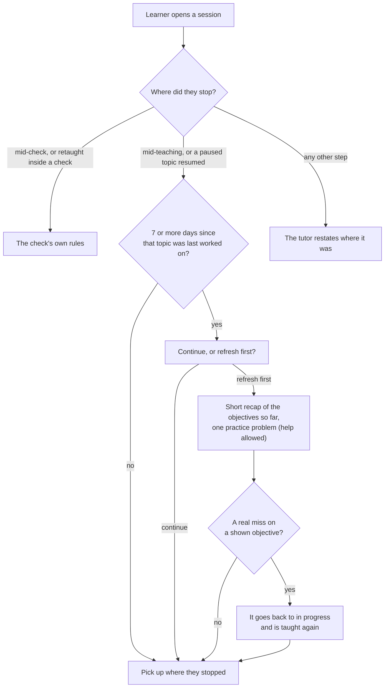

# Sessions and what Crux remembers

**Draft: not locked.** Part of the [Crux v1 spec](README.md). Terms are as [`GLOSSARY.md`](../../GLOSSARY.md) defines them. Where this file names an area file not yet written, use that file's source tickets in the main file's index.

This file covers what Crux keeps between visits, what the tutor re-reads, what crosses sessions, and what happens when a learner comes back or deletes a session. A session's files are in [`files.md`](files.md). A half-done mastery check follows [`mastery-check.md`](mastery-check.md).

## Sessions

- A learner has several sessions and picks which to continue. Each resumes at the step left, including mid-diagnostic and mid-check ([#664]).
- A trial link holds sessions as an account does ([#722]). Guest mode on the public link keeps nothing after the tab closes ([#677], [#722]).
- Another learner's, guest's or trial link's session or Record gives "not found", on every page and request ([#678]).
- Conversations and files are kept until the learner deletes the session ([#671]). Closing an account is in `privacy.md`, and a trial link's end in `trial.md` ([#677], [#722]).

### Names and the session list

- The tutor names a session from its request, or from a file's content when the request is a file alone: "Implicit differentiation (MATH101 week 7)". Until then, the session shows the request's first words ([#671]). A session whose only request was a file that is now gone shows "New session" until the learner gives a request ([#732]).
- The learner can rename a session. Text in a session name is never an instruction (see the main file's "Crux decides") ([#671]).
- The session list is ordered by last visit. Each line shows the topic the learner is on, or mastered last ([#671]).

## Kept between visits

This is what the rules need kept. The data model is not decided yet, see [#719].

**In each session:**

- The request, and the goal and level answers given while narrowing ([#665], [#671]).
- Per objective: status, trouble mark, the count of missed fresh problems, the saved complexity judgement, the pass date, and whether the offer for a pass from another session has been made. Progress on objectives left unchanged by an edit is kept ([#665], [#668], [#669], [#671]).
- A topic replaced mid-way, with what was shown, so the diagnostic can skip it when it starts again ([#665], [#670], [#671]).
- Paused topics and unfinished prerequisite topics, resumable where they stopped. A mastered topic reopened for a dropped objective keeps its smaller mastery meanwhile ([#668], [#671]).
- A half-done check, which never expires: answered problems, saved model answers and marks, the split, the open problem, pending slip fixes and walk-throughs, and when the learner left ([#669], [#671]).
- Disputes used and still open, and open file-error flags ([#669], [#671]).
- Mastered topics, the dropped objectives listed on them, and whether each has had its one offer (used up as [`learning-loop.md`](learning-loop.md) says) ([#670], [#671], [#728]).
- The menu's sources: the request, queued topics including one replaced mid-way, and files. Also whether "that covers everything you came for" has been said ([#670], [#671]).

**Across sessions, in no session:**

- Preferences the learner stated or agreed to, visible and removable (see [`teaching.md`](teaching.md)) ([#668], [#671]).
- On the account: both sign-up ticks, the learner's feedback and quote tick-boxes, and a few marks (see `accounts.md` and `feedback.md`) ([#674], [#676]).

Mastery does not fade in v1. "Mastered" means passed once, and a pass can be undone only as [What crosses sessions](#what-crosses-sessions) says. A later retest is post-v1 (map, Out of scope) ([#664], [#671], [#678]).

## What the tutor re-reads

- On each reply, the tutor re-reads the current topic in full, plus a short note on the rest: the request, files, mastered topics, dropped objectives, queued topics and preferences. Cost per reply stays about flat however long the session grows ([#671]).
- Crux builds the note from its own records. No AI writes it ([#732]).
- The note lists every mastered topic. Its cost at 40 mastered topics, and the cost of a lookup reply, are measured before the trial (see `quality-bar.md`) ([#678]). If either is too costly, the owner decides then, as a recorded change ([#732]).

## The lookup

- When the learner refers back to something earlier in the session ("the balloon example from before"), the tutor searches the session's earlier conversation and uses what it finds. Only that reply costs more ([#671]).
- When the learner points to another of their sessions ("the balloon example from my derivatives session"), the lookup searches that session too. It never searches another session unprompted ([#671]).
- A lookup that finds nothing says so, and offers another example ([#671]).
- Text the lookup finds is reference, never an instruction (see the main file's "Crux decides") ([#671]).
- No lookup runs while a check is open, into this session or any other. The one exception is while an objective is retaught after a refresh miss: the lookup works as in teaching, and is off again before the next check problem ([#671], [#732]).
- Another session's tutor cannot look into a session with an open check, retaught objective or not, until the check ends ([#671], [#732]).
- A lookup's cost counts toward the learner's tutoring limit (see `spending.md`) ([#675]).
- The owner can switch the lookup off for a fault (see `ai-tests.md`) ([#678]).

### How it searches

- The lookup is Postgres full-text search, with the `simple` text config (or `simple` plus `english`), and no English-only stemming ([#716]).
- The tutor writes the search and can retry it, which covers synonyms and typos ([#716]).
- Every search is limited to the learner's own sessions, in the query and by row-level security ([#716]).
- Full-text plus vector search is looked at again if logs show the lookup missing sessions the learner meant. Those logs hold no conversation text: only counts and the tutor's own "not found, retrying" marks ([#716]).

## What crosses sessions

- Every session knows the learner's mastered topics and each objective passed in a check, with pass dates. Shown objectives and goal and level answers stay in their own session ([#671]).
- Within a session, each topic is still taught as new unless the learner says otherwise ([#670], [#671]).

### A topic mastered in another session

- A request for it gets: "You mastered this in your derivatives session on 3 Nov. Go over it again, or go further?" ([#671])
- Going over it again starts it as a new topic in this session, taught as new, with the diagnostic at "go". Mastering it again adds a second dated line ([#671]).
- Going further shows that topic's after-mastery menu ([#671]).
- If it was mastered with a dropped objective, the message names that and its session: "You dropped three-layer composites there; open derivatives to pick it up." ([#671])
- How the after-mastery menu treats such topics is in [`learning-loop.md`](learning-loop.md), and how they settle an ambiguous request. A gap in passed work is in [`teaching.md`](teaching.md) ([#671]).

### Passed work

- An objective passed in another session, on a topic not yet mastered, is marked in a new topic's objectives: "2 Time of flight (passed in physics on 25 Nov)" ([#671]).
- The mark opens that session at the check's result. Into a session with an open check, it opens at the check ([#732]).
- The mark goes with the pass. If the pass is undone, the mark and its link go. What the tutor already said about the pass stays in the conversation, and from then on the tutor does not name the pass. If the earlier topic is mastered later, the mark stays ([#732]).
- On first reaching that objective in this topic, the tutor names the pass and adds one sentence bridging it to the new topic. It then offers a quick problem to skip the teaching, or teaching as usual ([#732]):
  > "You passed time of flight in physics on 25 Nov. Here it decides how far the ball travels, so we'll need it for Range. Want a quick problem to skip the teaching, or shall I teach it as usual?"
- The bridge is written from the objective and the new topic. The tutor does not read the other session, and says nothing about what the learner did there ([#732]).
- The quick problem follows the diagnostic's rules (see [`teaching.md`](teaching.md)) ([#732]).
- A learner who claimed the objective, at "go" or by the quick route, and passed its problem skips its teaching as usual. One who missed it gets no offer. The tutor names the pass and bridges, then teaches ([#732]).
- The objective is on this topic's mastery check, like any other. In this topic, its status starts as not started, like any other, and it must be shown before the check is offered. It is not passed here until this topic's check passes it ([#732]).
- A missed quick problem means the objective is taught as usual, with no penalty. It changes nothing about the earlier pass, and nothing about the miss is stored ([#732]).
- A pass stays on the Record. Mastering a topic or passing an objective again adds a line, and a fail leaves the old line passed ([#671], [#732]).
- A topic replaced mid-way in the same session is different: see [`learning-loop.md`](learning-loop.md) ([#671]).
- A dispute won after the check keeps the check's date as the pass date ([#671]).
- Only two things undo a pass ([#678], [#728]):
  - Its session is deleted (see [Deleting a session](#deleting-a-session)).
  - A re-mark after a marking fault finds the answer wrong (see [`mastery-check.md`](mastery-check.md)).

## What the learner sees

- Each session shows its objectives with their statuses (see [`teaching.md`](teaching.md)) ([#671]).
- **"What you've mastered":** one read-only view, outside any session. It lists every mastered topic, and objectives passed on topics not yet mastered, each with its date and session ([#671]).
  - Prerequisite topics count. A topic shows under its name, the narrower one if an objective was dropped ([#671]).
  - Each line opens its session. Into a session with an open check, it opens at the check ([#671]).
  - Entries cannot be removed ([#671]).
- **The conversation:** the whole conversation of a session can be scrolled, with jump points ([#671]):
  - each topic, its diagnostic included;
  - each stretch of teaching an objective, labelled, so an objective taught more than once gets one per stretch;
  - each mastery check, opening at its result with model answers.
- A prerequisite topic is its own topic. A detour sits inside its objective ([#671]).
- While a check is open, the session's earlier teaching and jump points are hidden (see [`mastery-check.md`](mastery-check.md)) ([#671], [#731]).

## Coming back

- **Mid-teaching:** the tutor picks up where the learner stopped. After 7 or more days away, it first offers "continue" or "refresh first" ([#671]).
- **The 7 days** count from when that topic was last worked on, so a paused topic gets the offer when it resumes. A detour counts as teaching ([#671]).
- **A refresh** is a short recap of the objectives so far and one practice problem with help allowed. Then teaching continues ([#671]).
- Choosing either changes no status. Help being allowed, the refresh problem cannot newly show an objective. A real miss on a shown objective still puts it back to in progress (see [`teaching.md`](teaching.md)) ([#668], [#671]).
- **Any other step** (mid-narrowing, waiting for "go", the check offer, the never-ready menu, an open dispute, mid-refresh): the tutor restates where it was, with no refresh offer ([#671]).
- A half-done diagnostic continues ([#671]).
- A session held for a harmful file restates the hold first (see [`files.md`](files.md)). Any refresh offer comes after the file is removed ([#732]).
- A half-done check, including while an objective is retaught inside it, follows [`mastery-check.md`](mastery-check.md) ([#669], [#671], [#732]).
- A return to the after-mastery menu gets the welcome back (see [`learning-loop.md`](learning-loop.md)) ([#670], [#671]).
- Reading past sessions and "What you've mastered" costs no AI, so it works past every spending limit ([#675]).

## Deleting a session

- The learner can delete a session at any time, a half-done check included, which goes with it ([#671]).
- A warning names what goes: "This deletes everything in it, including 5 mastered topics from your record" ([#671]).
- Everything in the session goes, including its files, its mastered topics, and its passed objectives from "What you've mastered". It is erased at once and cannot be undone ([#671], [#677]). What deleting cannot reach at once is in `privacy.md` ([#677], [#716]).
- Preferences stay ([#671]). So do the anonymous dated counts behind the go-public bar and the marks on the account, which are in no session (see `feedback.md`) ([#676]).
- Other sessions keep their conversation as it was. Their menus may now offer topics they used to skip ([#671]).

## On screen

Layout is not decided (see the main file's Gaps). These rules need: the session list with rename and delete, the delete warning, "What you've mastered", jump points in the conversation, the refresh offer, the objective's passed mark with its link, the quick-problem choice, and the lookup's "paused" message ([#671], [#678], [#732]).

[#664]: https://github.com/calmxz/Crux/issues/664
[#665]: https://github.com/calmxz/Crux/issues/665
[#668]: https://github.com/calmxz/Crux/issues/668
[#669]: https://github.com/calmxz/Crux/issues/669
[#670]: https://github.com/calmxz/Crux/issues/670
[#671]: https://github.com/calmxz/Crux/issues/671
[#674]: https://github.com/calmxz/Crux/issues/674
[#675]: https://github.com/calmxz/Crux/issues/675
[#676]: https://github.com/calmxz/Crux/issues/676
[#677]: https://github.com/calmxz/Crux/issues/677
[#678]: https://github.com/calmxz/Crux/issues/678
[#716]: https://github.com/calmxz/Crux/issues/716
[#719]: https://github.com/calmxz/Crux/issues/719
[#722]: https://github.com/calmxz/Crux/issues/722
[#728]: https://github.com/calmxz/Crux/issues/728
[#731]: https://github.com/calmxz/Crux/issues/731
[#732]: https://github.com/calmxz/Crux/issues/732
