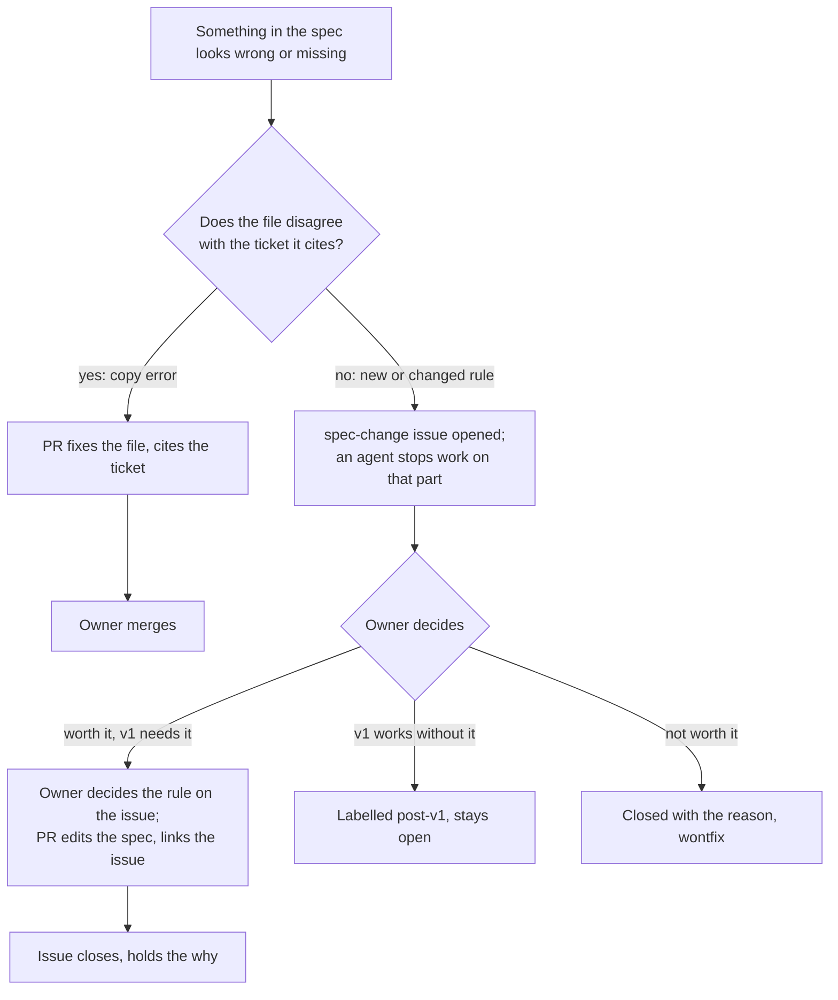

# How the spec changes

**Draft: not locked.** Part of the [Crux v1 spec](README.md). Terms are as [`GLOSSARY.md`](../../GLOSSARY.md) defines them.

This file covers how this spec is kept and changed, how build tickets use it, and how work is checked against it. All of it comes from [#680], unless a line says otherwise.

## Terms

These are process terms, so they stay out of the glossary.

- **Spec:** the current v1 rules, in `docs/spec/`. The closed tickets keep the reasons.
- **Main file:** `docs/spec/README.md`. It holds the shared rules and the index of area files.
- **Area file:** one spec file per subject.
- **Copy error:** a spec file that disagrees with the ticket it cites.
- **Spec-change issue:** an issue, labelled `spec-change`, that proposes a new or changed rule after the lock.
- **Stage issue:** the one issue per stage where its checklist is ticked.
- **Rule report:** the spec review's line per rule in a build ticket's sections: met (and what proves it), not met, or not tested.

## How the spec is laid out

- A build ticket's agent reads the main file, then the area files its ticket names.
- A rule goes in the main file if it limits more than one area and no area owns it. Otherwise it goes in its area file, and other areas link to it.
- Each file has one subject and stays under the repo's file-size check of 5,000 tokens.
- The spec states the current rule only. Each section links its source tickets, which keep the reasons.
- The glossary stays at the repo root and holds no rules. The spec uses its terms.
- The spec lives in this repo, in `docs/spec/`. If the map decides the new code lives in a new repo, the spec moves with it.

## Linked rules

Some kinds of rule need a matching edit in another file, in the same change ([#764]):

- a new email: its share row in [`operations.md`](operations.md);
- a new opening page: the order in [`accounts.md`](accounts.md);
- a new stored item: its row under "Stored items" in [`data-model.md`](data-model.md), and in the retention table in [`privacy.md`](privacy.md);
- a new safety or privacy action: the restore log in [`hosting.md`](hosting.md);
- a new screen element: the Frontend modules table of its screen file.

## Until the lock

- The main file says "Draft: not locked" until the map's destination is reached, then "Locked" with the date.
- Changes come from map tickets. Each resolution edits the spec files in the same pull request that updates the glossary, and posts no pointers.
- Anything still open is marked in its file as a gap. Nothing is guessed in.
- The map's Out of scope section is the parking lot.

When a writer finds two closed tickets that disagree, and one question settles it, the writer asks the owner on the spot. The file gets the answer, and the reason goes on the writer's ticket. If no one question settles it, or it reopens a decision, the writer marks it in the file as a conflict and opens a decision ticket on the map. The writer proposes which kind, and the owner can overrule.

## After the lock

This holds through the build, the trial and opening.

- A copy error is fixed by a pull request that cites the ticket. No issue is needed, since the ticket already holds the reason.
- Any new or changed rule gets a `spec-change` issue, whether an agent finds a gap or the owner changes their mind.
- The owner decides on the issue whether it is worth doing:
  - If v1 needs it, the owner decides the rule there, and a pull request edits the spec and links the issue.
  - If v1 works without it, it becomes a `post-v1` issue.
  - If it is not worth doing, it closes with the reason, labelled `wontfix`.
- An agent that hits a gap opens the issue and stops work on that part. It does not invent the rule.
- A change to the quality bar follows the same rule.

### `post-v1` issues

- After the lock, each idea v1 does not need is its own open issue, labelled `post-v1`.
- At the lock, each post-v1 line on the map's Out of scope list becomes one, linking the ticket that ruled it out. Two lines stay on the map: the paid launch (a separate effort) and fixing the old code (not an idea).
- Demand for an idea collects as comments on its issue.
- A `post-v1` issue never also gets a triage label such as `ready-for-agent`.
- The labels `spec-change` and `post-v1` are created at the lock.

## Build tickets and pull requests

- Each build ticket names the spec sections it builds, for example "Spec: `mastery-check.md`, Disputes". The owner approves that line with the ticket, before work starts.
- Every build ticket also names [`old-code.md`](old-code.md), which says what of the old code its module copies ([#750], [#769]).
- A build pull request names only its ticket ("Closes #n"). A pull request with no ticket, such as a dependency bump, names nothing. A spec-change pull request names its `spec-change` issue.
- No pull request template is needed.

## The rule report

The spec review gives one line per rule in the ticket's sections, with what proves it. Three kinds of "met" count:

- an ordinary test that passed;
- an AI test, named, that runs in the round before release. The pull request may merge, but the change goes live only as [`ai-tests.md`](ai-tests.md) allows ([#678]);
- "seen on staging", for what only a person can judge, such as whether a screen reads well on a phone.

The owner merges only when every rule is met. The owner tries anything a learner sees once on staging, and reads one test from the report, of their choice, to check that it really tests its rule.

## Stage issues

What each stage needs is listed in [`quality-bar.md`](quality-bar.md), without checkboxes.

- When a stage is near, one stage issue copies that stage's list as checkboxes: "Stage check: before the trial", and later "Stage check: before opening".
- Agents tick the items they can verify, with proof such as a link to a test run. The owner ticks the items only they can do in their own accounts, such as accepting the processors' terms.
- An item that takes real work gets its own issue, linked from the stage issue, and is ticked when that issue closes.
- The owner closes the stage issue, which starts the stage. The closed issue is the dated record of what was checked.

## The decision log

- The README's "key decisions with their reasons" links the closed tickets and `spec-change` issues ([#678]). No `docs/decisions.md` is started for v1.
- Each closed Decide ticket gets one comment once all the area files are merged: "Current rules: `docs/spec/<file>`. This ticket keeps the reasons."

[#678]: https://github.com/calmxz/Crux/issues/678
[#680]: https://github.com/calmxz/Crux/issues/680
[#750]: https://github.com/calmxz/Crux/issues/750
[#764]: https://github.com/calmxz/Crux/issues/764
[#769]: https://github.com/calmxz/Crux/issues/769
